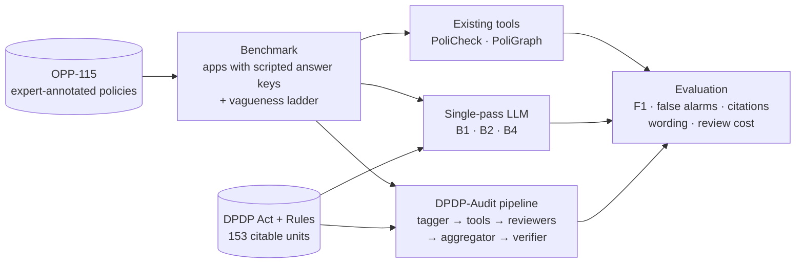

# DPDP-Audit

**A controlled benchmark and an evidence-gated LLM agent for checking app privacy compliance under
India's Digital Personal Data Protection (DPDP) Act, 2023.**

> Course project, Language Models and Agents (IIIT Hyderabad), team Neural Nexus. Status: **complete**
> (final submission 15 Nov 2026) · [plan](plan.md) · [specs](specs.md) · [final analysis](docs/final-analysis.md)

## Overview

An app's privacy policy says what personal data it collects, why, and who receives it. Its code and
third-party SDKs may do something else: a policy that says *"we do not share your location"* can sit
next to an advertising SDK that receives it. DPDP-Audit measures how well automated systems find these
**compliance gaps**:
- existing rule-based checkers;
- single-prompt LLM review;
- our evidence-gated multi-agent pipeline.

Every reported gap must carry the policy's own words and the right DPDP section.



## Results

**Main benchmark:** 102 app/policy cases built from the expert-annotated OPP-115 corpus, 118 gold gaps,
answer keys computed by fixed rules (no LLM). Qwen2.5-7B-Instruct for B1, B2, B5 and the pipeline;
B4 = Gemini 3 Flash; mean of three seeds (one deterministic run for the tools and R0).

| System | F1 | False-alarm rate | Citation correct |
|---|---|---|---|
| S1 PoliCheck | 0.149 | 0.912 | — |
| S2 PoliGraph | 0.166 | 0.853 | — |
| B1 · one prompt, raw inputs | 0.182 | 0.971 | 0.325 |
| B2 · one prompt, parsed facts + DPDP text | 0.181 | 0.745 | 0.894 |
| B4 · B2's prompt, Gemini 3 Flash | 0.421 | 0.971 | 0.996 |
| R0 · rules only (tagger + finder, no LLM) | 0.524 | 0.912 | 1.000 |
| B5 · one call over the whole policy, evidence first | 0.557 | 0.255 | 0.350 |
| DPDP-Audit v1 (frozen), QLoRA tagger | 0.168 | 0.275 | 1.000 |
| DPDP-Audit v2, prompted tagger | 0.692 | 0.294 | 1.000 |
| **DPDP-Audit v2, QLoRA tagger (headline)** | **0.705** | **0.265** | **1.000** |

The headline system is significantly ahead of every baseline on every seed (B2: +0.54 F1; B4: +0.31 F1
and −0.77 false-alarm rate; PoliCheck: +0.57 F1), at about the token cost of one B2 call.

| Evaluation | Data | Result |
|---|---|---|
| Vagueness ladder | 35 policies × 4 rungs, 110 accepted by two human checkers | Clear rungs read perfectly, deleted rungs are over-read (0.14); no system is weaker on vague than on explicit rungs (H4 fails) |
| Selective accuracy | per-flow confidence over 3 seeds | 95% accuracy after a person reviews 21% of flows, against 100% for B2 (H5 partly supported) |
| Real app traffic | 61 flows from 33 apps, two labellers (κ 0.728) | Flags 14% of disclosed flows, where every baseline and tool flags all of them; κ with the labellers 0.34–0.45 |
| Open-source case study | Aarogya Setu, Wikipedia, DuckDuckGo (13 flows, hand-checked) | 7 correct, 3 partly correct, 3 wrong; finds Aarogya Setu sending data to Google despite its policy's denial |

Hypothesis verdicts, the cost table, error patterns and worked failure cases:
[docs/final-analysis.md](docs/final-analysis.md). Full results: [mid-submission report](docs/mid-submission-report.md)
(benchmark, ablations, tagger) and [Stage 4 report](docs/stage-4-report.md) (selective accuracy, real
flows, case study).

## Quick start

```bash
python3 -m venv .venv && . .venv/bin/activate
pip install -r requirements.txt && pip install -e ".[dev]"
pytest -q                                   # 143 tests

scripts/download_opp115.sh                  # OPP-115 corpus → data/raw/
python scripts/generate_cases.py            # rebuilds data/benchmark/main/ (byte-identical)
bash scripts/score_all.sh                   # every score in results/scores/ from the committed runs (~2 min, no GPU)
```

Every model run is committed under `results/runs/`, so `score_all.sh` reproduces every number in the
reports without a GPU. Re-running a system needs Kaggle (`scripts/kaggle_push_job.sh <job>`); the
tools run in Docker (`scripts/tools/`). Step by step: [reproduction.md](reproduction.md).

## Repository structure

```
DPDP-Audit/
├── src/dpdp_audit/   library: benchmark builder, tools, retrieval, LLM client, baselines, scoring
├── scripts/          command-line entry points (scripts/tools/ wraps PoliCheck and PoliGraph)
├── kaggle/           unattended Kaggle GPU jobs, one folder per job
├── notebooks/        interactive Kaggle notebook
├── tests/            pytest suite
├── data/             versioned inputs: benchmark, DPDP units, mappings, split
├── results/          versioned results: runs, scores, tool outputs
├── docs/             proposal, architecture, guides, reports
├── reproduction.md   commands to regenerate every result
├── plan.md           project plan
└── specs.md          specifications
```

## Documentation

| Document | Contents |
|---|---|
| [docs/final-analysis.md](docs/final-analysis.md) | Hypothesis verdicts, cost per case, failure patterns and worked cases |
| [docs/mid-submission-report.md](docs/mid-submission-report.md) | Benchmark, baselines, pipeline v1/v2, ablations, ladder, tagger (Stages 2–3) |
| [docs/stage-4-report.md](docs/stage-4-report.md) | Selective accuracy, real app traffic, open-source case study (Stage 4) |
| [docs/manual-checks.md](docs/manual-checks.md) · [docs/real-flow-labelling.md](docs/real-flow-labelling.md) | Human checks and labelling: guides and rules |
| [docs/README.md](docs/README.md) | Documentation index and reading paths |
| [docs/getting-started.md](docs/getting-started.md) | The problem and every concept, from zero |
| [docs/architecture.md](docs/architecture.md) | System context, components, design principles |
| [docs/pipeline.md](docs/pipeline.md) · [docs/benchmark.md](docs/benchmark.md) · [docs/evaluation.md](docs/evaluation.md) · [docs/infrastructure.md](docs/infrastructure.md) | Detailed architecture |
| [plan.md](plan.md) | Milestones, schedule, work breakdown, RACI, risks |
| [specs.md](specs.md) | Specifications SPEC-01 … SPEC-09 with acceptance criteria |
| [docs/Neural_Nexus_Final.pdf](docs/Neural_Nexus_Final.pdf) | Submitted proposal |

## Team

| Role | Member | Area |
|---|---|---|
| M1 | Anurag Kaushal | Data and benchmark |
| M2 | Ishaan Giri | Tools and existing systems |
| M3 | Naveen Mishra | Agent pipeline |
| M4 | Nikhil Patidar | Fine-tuning and evaluation |

## Licence

- **Code:** MIT ([LICENSE](LICENSE)).
- **OPP-115-derived data:** the policy texts and annotations under `data/benchmark/` and the split in
  `data/splits.json` remain under the OPP-115 terms (research, teaching and scholarship only, in the
  spirit of CC BY-NC; cite Wilson et al., ACL 2016).
- **DPDP text:** the units in `data/dpdp/` are derived from the Government of India's Gazette
  publications of the DPDP Act, 2023 and the DPDP Rules, 2025.
