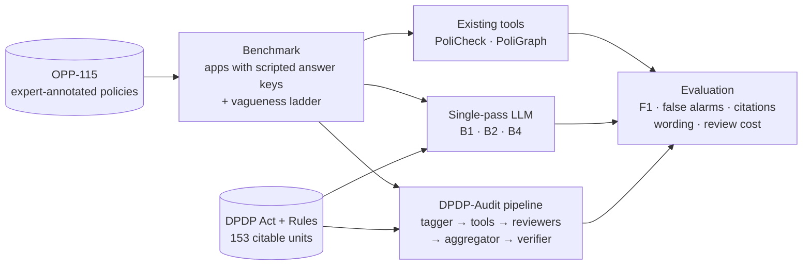

# DPDP-Audit

**A controlled benchmark and an evidence-gated LLM agent for checking app privacy compliance under
India's Digital Personal Data Protection (DPDP) Act, 2023.**

> Course project, Language Models and Agents. Status: Stage 2 (mid-submission) complete except the human checks and the fine-tuned tagger.
> Mid-submission **30 Oct 2026** · final submission **15 Nov 2026** · [plan](plan.md) · [specs](specs.md)

## Overview

An app's privacy policy says what personal data it collects, why, and who receives it. Its code and
third-party SDKs may do something else: a policy that says *"we do not share your location"* can sit
next to an advertising SDK that receives it. DPDP-Audit measures how well automated systems find these
**compliance gaps**:
- existing rule-based checkers;
- single-prompt LLM review;
- our evidence-gated multi-agent pipeline.

Every reported gap must carry the policy's own words and the right DPDP section.



## Results so far (Stage 2)

Main benchmark: 102 cases, 118 gold gaps. Qwen2.5-7B-Instruct for B1, B2 and the pipeline (mean of
three seeds); one deterministic run for the tools; B4 = Gemini 3 Flash, seed 0.

| System | F1 | False-alarm rate | Citation correct |
|---|---|---|---|
| S1 PoliCheck | 0.149 | 0.912 | — |
| S2 PoliGraph | 0.166 | 0.853 | — |
| B1 · one prompt, raw inputs | 0.182 | 0.971 | 0.325 |
| B2 · one prompt, parsed facts + DPDP text | 0.181 | 0.745 | 0.894 |
| B4 · B2's prompt, Gemini 3 Flash | 0.414 | 0.971 | 1.000 |
| **DPDP-Audit, prompted tagger** | **0.343** | 0.471 | **1.000** |
| **DPDP-Audit, QLoRA tagger** | 0.321 | **0.333** | **1.000** |

With the same model and inputs, the evidence-gated pipeline nearly doubles B2's F1 (+0.15, 95%
interval [+0.05, +0.26]) and lowers false alarms. Details, ablations and the ladder:
[docs/mid-submission-report.md](docs/mid-submission-report.md).

## Quick start

```bash
python3 -m venv .venv && . .venv/bin/activate
pip install -r requirements.txt && pip install -e ".[dev]"
pytest -q                                   # 70 tests

scripts/download_opp115.sh                  # OPP-115 corpus → data/raw/
python scripts/generate_cases.py            # rebuilds data/benchmark/main/ (byte-identical)
python scripts/score_runs.py --systems B1 B2  # re-scores the committed runs
```

GPU runs use Kaggle (`scripts/kaggle_push.sh`), PoliCheck runs in Docker (`scripts/tools/`). See
[docs/reproduction.md](docs/reproduction.md).

## Repository structure

```
DPDP-Audit/
├── src/dpdp_audit/   library: benchmark builder, tools, retrieval, LLM client, baselines, scoring
├── scripts/          command-line entry points (scripts/tools/ wraps PoliCheck and PoliGraph)
├── kaggle/           unattended GPU job for the LLM systems
├── notebooks/        interactive Kaggle notebook
├── tests/            pytest suite
├── data/             versioned inputs: benchmark, DPDP units, mappings, split
├── results/          versioned results: runs, scores, tool outputs
├── docs/             proposal, architecture, guides, reports
├── plan.md           project plan
└── specs.md          specifications
```

## Documentation

| Document | Contents |
|---|---|
| [docs/mid-submission-report.md](docs/mid-submission-report.md) | Stage 2 results (mid-submission) |
| [docs/manual-checks.md](docs/manual-checks.md) | Manual checks to do by hand: owners and instructions |
| [docs/README.md](docs/README.md) | Documentation index and reading paths |
| [docs/getting-started.md](docs/getting-started.md) | The problem and every concept, from zero |
| [docs/architecture.md](docs/architecture.md) | System context, components, design principles |
| [docs/pipeline.md](docs/pipeline.md) · [docs/benchmark.md](docs/benchmark.md) · [docs/evaluation.md](docs/evaluation.md) · [docs/infrastructure.md](docs/infrastructure.md) | Detailed architecture |
| [plan.md](plan.md) | Milestones, schedule, work breakdown, RACI, risks |
| [specs.md](specs.md) | Specifications SPEC-01 … SPEC-09 with acceptance criteria |
| [docs/Neural_Nexus_Final.pdf](docs/Neural_Nexus_Final.pdf) | Submitted proposal |

## Team

| Role | Member | Area |
|---|---|---|
| M1 | Anurag Kaushal | Data and benchmark |
| M2 | Ishaan Giri | Tools and existing systems |
| M3 | Naveen Mishra | Agent pipeline |
| M4 | Nikhil Patidar | Fine-tuning and evaluation |

## Licence

- **Code:** MIT ([LICENSE](LICENSE)).
- **OPP-115-derived data:** the policy texts and annotations under `data/benchmark/` and the split in
  `data/splits.json` remain under the OPP-115 terms (research, teaching and scholarship only, in the
  spirit of CC BY-NC; cite Wilson et al., ACL 2016).
- **DPDP text:** the units in `data/dpdp/` are derived from the Government of India's Gazette
  publications of the DPDP Act, 2023 and the DPDP Rules, 2025.
