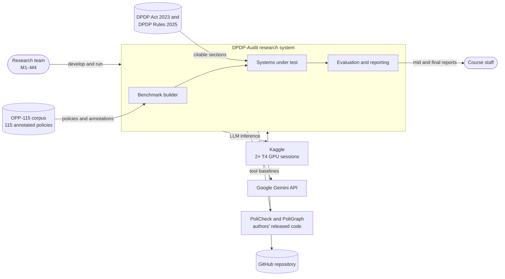
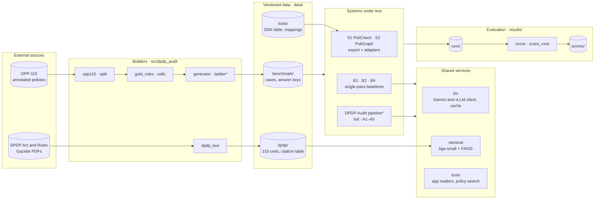

# Architecture overview

DPDP-Audit is a research system with three parts:

1. A **benchmark builder** that creates test cases with known answers.
2. The **systems under test**: existing tools, single-pass LLM baselines and the DPDP-Audit pipeline.
3. An **evaluation layer** that scores every system on the same cases.

This page shows how the parts fit together. Each part has its own page:

| Page | Covers |
|---|---|
| [benchmark.md](benchmark.md) | Case generation, answer-key rules, data model, vagueness ladder, tool export |
| [pipeline.md](pipeline.md) | The six-stage DPDP-Audit pipeline, reviewer agents, evidence verifier, ablations |
| [evaluation.md](evaluation.md) | Systems under test, experiment matrix, scoring views, statistics, selective accuracy |
| [infrastructure.md](infrastructure.md) | Where everything runs: laptops, Docker, Kaggle GPUs, the PoliGraph workstation, Gemini |

## System context



## Containers and components

Components marked `*` are planned (Stage 2 onwards). Everything else is implemented.



## Component status

| Component | Module(s) | Status |
|---|---|---|
| OPP-115 loader, policy split | `opp115.py`, `split.py` | Implemented |
| DPDP units, gap-to-section table | `dpdp_text.py`, `gaps.py` | Implemented |
| DPDP retrieval index | `retrieval.py` | Implemented |
| App readers and policy search | `tools/` | Implemented |
| Answer-key rules, cell counts, case generator | `gold_rules.py`, `cells.py`, `generator.py` | Implemented |
| PoliCheck export and adapter | `export_policheck.py`, `tool_runs.py` | Implemented |
| PoliGraph adapter | `scripts/tools/run_poligraph.sh`, `kaggle/poligraph/` | Run on main and the ladder |
| LLM client | `llm.py` | Implemented |
| Single-pass baselines B1, B2, B4 | `baselines.py` | Run (3 seeds each on main; B2 also on the ladder) |
| Scorer | `score.py`, `scripts/score_runs.py` | Implemented |
| DPDP-Audit pipeline and ablations | `pipeline/`, `scripts/run_pipeline.py`, `scripts/reverify.py` | v1 (frozen) and v2 run on main and the ladder; ablations on both (SPEC-04) |
| Clause tagger training and evaluation | `tagger_data.py`, `tagger_eval.py`, `scripts/train_tagger.py` | QLoRA tagger trained and evaluated; S4 extraction comparison done (`s4.py`) (SPEC-05) |
| Vagueness ladder | `ladder.py` | Built, checked by two members and scored (SPEC-06) |
| Selective accuracy | `selective.py` | Planned (SPEC-07) |

## Design principles

1. **Known answers.** Answer keys come from fixed rules over expert annotations, never from an LLM
   ([benchmark.md](benchmark.md#answer-key-rules)).
2. **Same information for every LLM system.** B2 receives exactly the facts and DPDP text the pipeline
   receives, so a gain over B2 comes from the design, not from extra input.
3. **Evidence gating.** The pipeline reports a gap only with a verbatim quote (none for an omission,
   where the policy has nothing to quote) and an existing DPDP section.
4. **Fair tool comparison.** Tools are scored on the gap types they support, under both our reading
   and theirs ([evaluation.md](evaluation.md#fair-comparison)).
5. **Reproducibility.** Fixed seeds, frozen mappings, a cached LLM client, byte-identical regeneration,
   and versioned results ([developer-guide.md](developer-guide.md#conventions)).

## Repository layout

```
DPDP-Audit/
├── README.md · LICENSE · plan.md · specs.md · pyproject.toml · requirements.txt · .env.example
├── src/dpdp_audit/        library code (see the developer guide for each module)
├── scripts/               command-line entry points; scripts/tools/ wraps PoliCheck and PoliGraph
├── kaggle/b1b2/           unattended GPU job (Qwen on vLLM) for the LLM systems
├── notebooks/             interactive Kaggle notebook (same configuration)
├── tests/                 pytest suite and fixtures
├── data/                  versioned inputs: benchmark, DPDP units, mappings, split
├── results/               versioned results: runs, scores, tool outputs, model checks
├── outputs/               local scratch (ignored): caches, logs, Kaggle staging
└── docs/                  proposal (PDF + summary), architecture, guides, report
```
