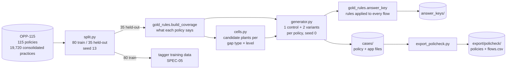
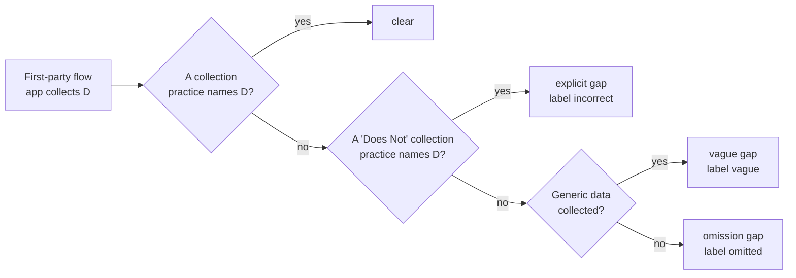
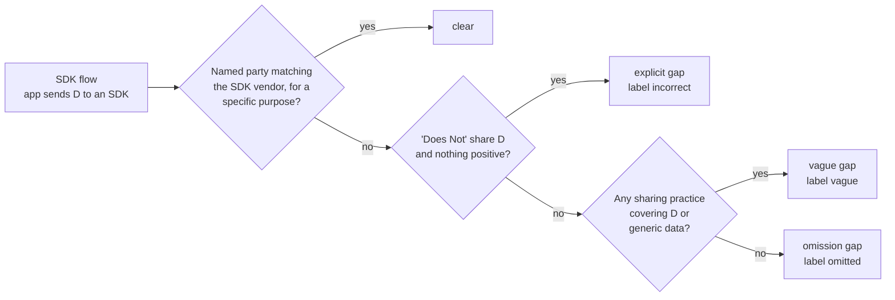
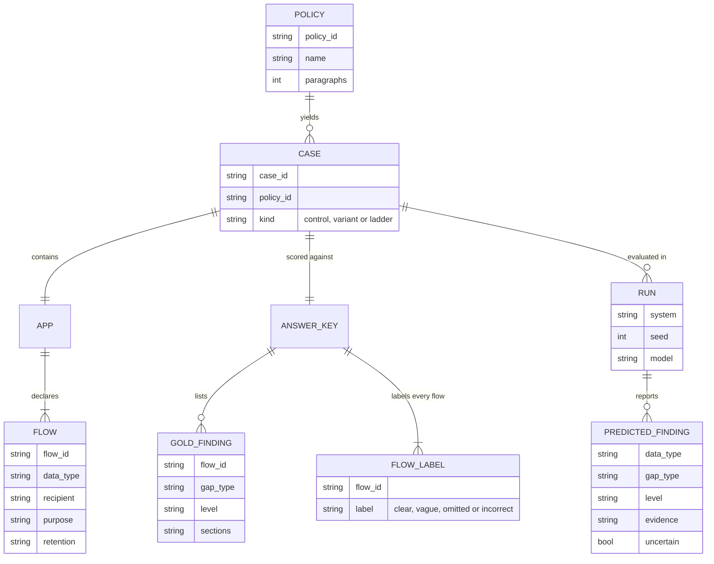
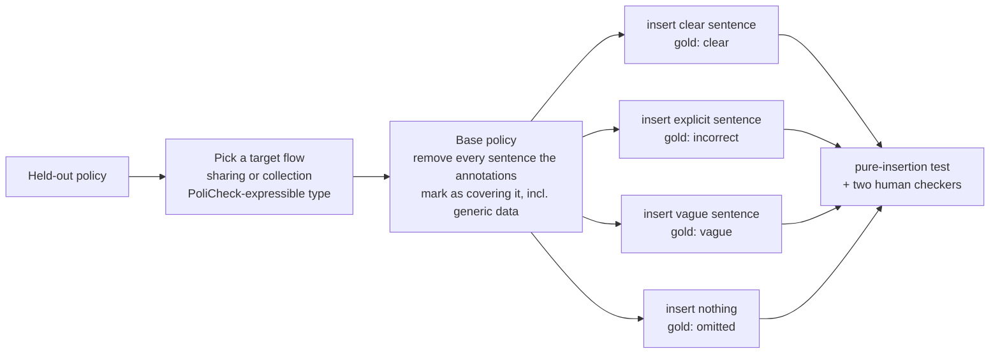

# Benchmark

The benchmark supplies test cases whose correct answers are known in advance. It has four parts:

| Part | Cases | Answer source | Status |
|---|---|---|---|
| Main benchmark | 102 (34 controls, 68 variants) | Scripted rules over OPP-115 annotations | Implemented |
| Vagueness ladder | 140 (35 ladders × 4 rungs) | Construction (templated rung sentences) | Built; human check pending (SPEC-06) |
| Real flows | ~25 apps, 60–80 flows | Two independent human labels (Cohen's κ) | Planned (SPEC-08) |
| Open-source case study | 3–5 repositories | Every finding checked by hand | Planned (SPEC-08) |

## What a case is

A case is **not a working app**. It is a policy plus three small files that describe what an app does.
The systems under test read these files; none of them runs the app.

```
data/benchmark/main/cases/1028_v1/
├── policy.txt              privacy policy, one OPP-115 paragraph per block
├── meta.json               {"case_id", "policy_id", "policy_name"}   (never the answer)
└── app/
    ├── build.gradle        SDK dependencies, e.g. com.google.android.gms:play-services-ads
    ├── AndroidManifest.xml permissions, e.g. READ_CONTACTS, AD_ID; child_directed flag
    └── dataflows.json      [{"flow_id", "data_type", "recipient", "purpose", "retention"}]
data/benchmark/main/answer_keys/1028_v1.json
```

## Generation pipeline



The steps for each held-out policy:

1. **Coverage.** Index what the annotations say: data types collected and their purposes; data types
   shared, with named or unnamed parties and purposes; data types explicitly not collected or shared;
   retention promises; children statements.
2. **Control.** Up to 3 first-party collection flows covered with a specific purpose, plus up to 2
   sharing flows where the policy names the SDK's vendor for a specific purpose. The rules must give
   the control **zero findings**. One policy has no such flow and produces no case.
3. **Variants.** Two copies of the control, each with 1–2 planted flows, chosen from the cells used
   least so far, so rare cells fill first.
4. **App files.** `build.gradle` gets the SDK package names for the recipients, `AndroidManifest.xml`
   the permissions for the data types, and `dataflows.json` the flows.
5. **Answer key.** The rules applied to **every** flow of the app.

Regenerating with the same seeds reproduces the committed files byte for byte.

## Answer-key rules





A flow whose notice is clear is then checked by the purpose rule; first-party flows are also checked by
the retention rule, and flows to ad/tracking SDKs from a child-directed app by the children rule.

| Gap type | Explicit | Vague | Omission | Gold DPDP |
|---|---|---|---|---|
| Undisclosed collection | "Does Not" collection names the type | only generic data is collected | no collection practice mentions it | Sec. 5(1), 6(1) |
| Undisclosed sharing | "Does Not" sharing names the type and nothing positive | shared only with unnamed parties, for unspecified purposes, or as generic data | no sharing practice mentions it | Sec. 5(1), 6(1) |
| Purpose mismatch | — | the type is collected only for "Unspecified"/"Other" purposes | stated purposes exclude the app's purpose | Sec. 5(1), 6(1) |
| Retention mismatch (app keeps data indefinitely) | a "Stated Period" or "Limited" retention practice | only "Unspecified" retention | no retention practice | Sec. 8(7) |
| Children's data (child-directed app → ad/tracking SDK) | a Children audience practice | — | no Children audience practice | Sec. 9(3) |

- Purpose gaps are checked only on flows whose notice is clear.
- Generic negative statements are not explicit contradictions (see the design notes below).
- Accepted citations per gap type are in `data/dpdp/gap_to_section.csv`.

## Design notes

### Scripted answer keys

- No LLM and no team member decides an answer. Keys are computed by the rules above, applied to the
  consolidated OPP-115 annotations (overlap threshold 0.75).
- Every flow of an app is checked, not only the planted one, so a planted flow that also triggers
  another rule produces both gaps. Controls are verified to have zero findings before they are
  written.
- Humans only spot-check (20 cases) and check the ladder rungs. Key quality is bounded by annotation
  quality, and the spot-check reports the error rate.
- The rules and mappings are frozen before the Stage 3 runs. Changing them invalidates the stored
  runs.

### Generic negative statements

23 of the 35 held-out policies contain a negative sharing statement about *generic* data. Read in
context, these are almost always qualified:
- "we do not **sell** your personal information" (selling is not sharing);
- "...**except as described** in this policy";
- "...for **their own marketing** purposes";
- statements about aggregate data or about children only.

Counting them as contradictions would put wrong answers in the keys. So only "Does Not" practices that
**name the data type** count as explicit. As a result, explicit and omitted collection/sharing cells
are rare. Cells under 10 keep their true labels but are reported as exploratory, and the vagueness
ladder supplies controlled explicit and omission cases.

## Data model



Answer key example (`1028_v1`, abridged):

```json
{
  "case_id": "1028_v1", "policy_id": "1028", "kind": "variant",
  "findings": [{"flow_id": "f4", "data_type": "Computer information",
                "gap_type": "undisclosed_sharing", "level": "vague",
                "sections": ["Sec. 5(1)", "Sec. 6(1)"]}],
  "flow_labels": {"f1": "clear", "f2": "clear", "f3": "clear", "f4": "vague"},
  "flow_gap_types": {"f1": "undisclosed_collection", "f4": "undisclosed_sharing"}
}
```

## Main benchmark in numbers

| Measure | Value |
|---|---|
| Held-out policies | 35 (34 with a case) |
| Cases | 102 = 34 controls + 68 variants |
| Gold findings | 118 |
| Flows (labels) | 433 (clear 385 · vague 35 · omitted 7 · incorrect 6) |

Policies that can host each gap type × level (`data/benchmark/cell_counts.csv`). Cells under 10 are
reported as exploratory:

| Gap type | explicit | vague | omission |
|---|---|---|---|
| Undisclosed collection | 3 | 33 | 2 |
| Undisclosed sharing | 2 | 33 | 3 |
| Purpose mismatch | 0 | 32 | 29 |
| Retention mismatch | 12 | 15 | 12 |
| Children's data | 27 | – | 8 |

## Vagueness ladder (SPEC-06)

The ladder isolates the effect of wording: the same policy and the same app, with exactly one
sentence changed.



| Rung | Inserted sentence (sharing template) | Gold label |
|---|---|---|
| Clear | "We share your precise location with our advertising partner Google (AdMob) to show you relevant ads." | clear |
| Explicit | "We do not share your precise location with third parties." | incorrect |
| Vague | "We may share information with our partners." | vague |
| Deleted | — | omitted |

Collection ladders use "We collect your {data} to provide and operate the features of our app.", "We
do not collect your {data}." and "We may collect information about you when you use our services."

### As built (`scripts/build_ladder.py`, `src/dpdp_audit/ladder.py`)

| Measure | Value |
|---|---|
| Ladders | 35 (23 sharing, 12 collection), one per held-out policy |
| Cases | 140 (`L<policy>_r1` … `_r4` = clear, explicit, vague, deleted) |
| Data types | Location 8 · IP address and device IDs 10 · Computer information 8 · Contact 6 · Personal identifier 3 |
| Recipients (sharing) | AdMob (Advertising) and Mixpanel (Analytics/Research), alternating |
| Sentences removed for the base policies | 735 (2 ladders needed none) |
| Ladders with residual-mention flags | 23 (see `removed_sentences.json`) |

**Known inconsistency: "Personal identifier".** On its 3 ladders the inserted sentences say "your
name and other personal identifiers" and the removal list includes "name" and "username"
(`ladder.py`), while the pipeline's glossary and keywords (`pipeline/vocab.py`) and the OPP-115 type
mean government identifiers (social security number, passport, driver's licence); PoliCheck's mapping
uses `real_name`. The ladder is kept as built (rebuilding it would require re-running every system);
results on these 3 ladders should be read with this in mind.
| PoliCheck export | 140 of 140 flows (23% exact mapping) |

- **Target choice:** the data type is drawn from the types the policy addresses for the practice
  (seed 0), so that removal is tested; the app has one flow, identical across the four rungs.
- **Removal:** a sentence is removed when it overlaps any annotated span of a practice of the target
  category whose data type is the target, a generic type or missing, in either direction.
- **Insertion:** at the position of the first removed sentence, or at the end of the first paragraph
  when nothing was removed. `tests/test_ladder.py` checks that each rung minus its sentence equals the
  deleted rung, character for character.
- **Residual flags:** base sentences that still name the data type (or, for sharing, generic data)
  next to a practice verb. They are leads for the checkers, not verdicts.
- **Human check (WP-2.2):** `check_sheet.csv` has one row per rung and two checker columns. Scoring
  (`scripts/score_ladder.py`) uses only rungs both checkers mark `ok` once the sheet is complete, and
  every rung until then (reported as such).

## Export for the existing tools

`export_policheck.py` writes each case as `plaintext_policies/<package>.txt` plus a `flows.csv` in
PoliCheck's format. PoliGraph reads the same files. PoliCheck knows 16 data tokens, so our data types
are mapped through `data/tools/datatype_mapping.csv`:

| Quality | Example | Share of benchmark flows |
|---|---|---|
| Exact | Location → `geolatlon` | 12% |
| Approximate | Contact → `email`, IP address and device IDs → `aaid` | 53% |
| Not expressible | Health, Financial, Demographic, … | 35% (not exported) |

SDK recipients map to destination domains through `data/tools/sdk_domains.csv` (e.g. `admob` →
`googleads.g.doubleclick.net`). Coverage is written to `export/policheck/coverage.json`.
