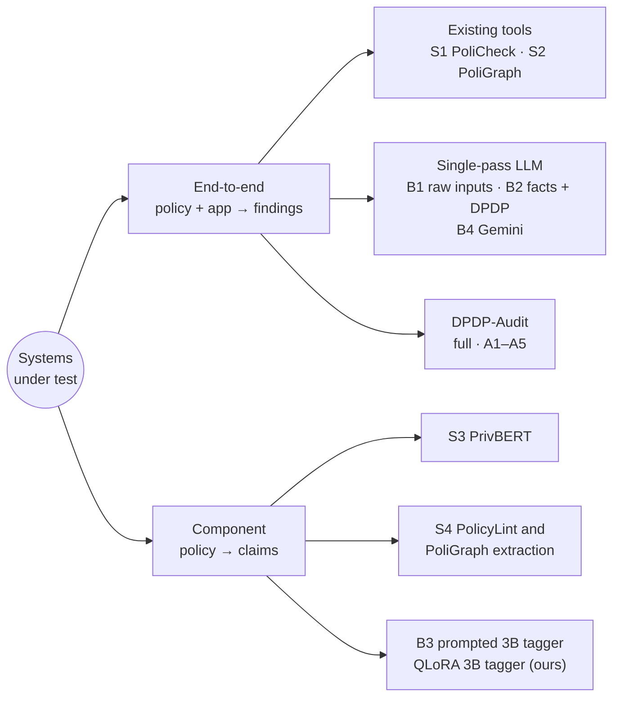
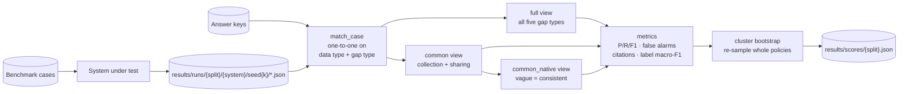
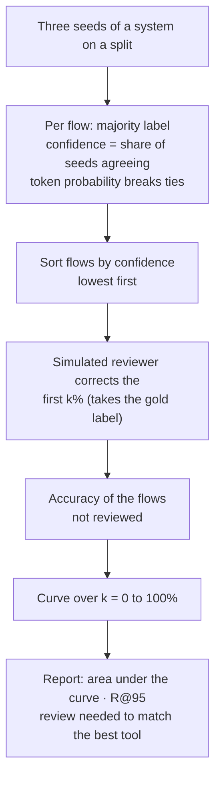

# Evaluation

## Systems under test

| ID | System | Model / implementation | Gap types | Seeds |
|---|---|---|---|---|
| S1 | PoliCheck | Authors' code in Docker | collection, sharing | 1 (deterministic) |
| S2 | PoliGraph | Authors' released code (NLP) | collection, sharing | 1 (deterministic) |
| B1 | Single pass, raw inputs | Qwen2.5-7B-Instruct-AWQ | all | 3 |
| B2 | Single pass, parsed facts + DPDP text | Qwen2.5-7B-Instruct-AWQ | all | 3 |
| B4 | B2's prompt, stronger model | `gemini-3-flash-preview` | all | 3 |
| full | DPDP-Audit, frozen 26 Oct (prompted tagger; `full_finetuned` with the QLoRA tagger) | Qwen2.5-7B + tagger | all | 3 |
| full_v2 | DPDP-Audit v2, chosen on the dev splits ([pipeline.md](pipeline.md#v2)); `full_v2_finetuned` with the QLoRA tagger | Qwen2.5-7B + tagger | all | 3 |
| A1–A5 | Ablations | as full, one change each; `A*_v2` as full_v2_finetuned | all | 1 |
| `*_rv` | The same runs with only the verifier re-run by the robust reply reader ([pipeline.md](pipeline.md#evidence-verifier)); the reported numbers | as the system | all | as the system |
| S3 | PrivBERT | `mukund/privbert`, fine-tuned on our split | tagging only | 1 |
| S4 | PolicyLint and PoliGraph extraction | Authors' code | statement extraction | 1 |
| B3 | Prompted 3B tagger | Qwen2.5-3B-Instruct, zero-shot | tagging only | 1 |

Purpose, retention and children's-data gaps have no existing-tool baseline. For those types, the
comparison is with the LLM systems only, and coverage is reported next to F1.

## Experiment matrix

| System | Main (102) | Ladder (140) | Real flows | Status |
|---|---|---|---|---|
| S1 PoliCheck | ✓ | ✓ | ✓ | Main and ladder done |
| S2 PoliGraph | ✓ | ✓ | ✓ | Main and ladder done |
| B1 | ✓ | — | ✓ | Done (306 runs) |
| B2 | ✓ | ✓ | ✓ | Main and ladder done (3 seeds each) |
| S4 PolicyLint, PoliGraph (extraction) | — | — | — | 1,140 held-out OPP-115 segments, tuple F1 (done) |
| B4 | ✓ | — | — | Done (3 seeds) |
| full, full_finetuned | ✓ | ✓ | ✓ | Main and ladder, 3 seeds |
| full_v2, full_v2_finetuned | ✓ | ✓ | ✓ | Main and ladder, 3 seeds |
| A1–A5 | ✓ | A2_v2, A3_v2 | — | A1, A2, A3, A5 on the frozen pipeline (seed 0); A1_v2, A2_v2, A3_v2, A5_v2 on v2, 3 seeds (A4 on v2 = full_v2); A2_v2, A3_v2 on the ladder, 3 seeds |

## Run and scoring flow

### Matching

A predicted finding is a **true positive** when its data type and gap type match an answer-key entry
of the same case. Each entry can be matched once, and the level does not need to match. Findings
marked `uncertain` count as not reported and are listed separately.

### Metrics

| Group | Metric | Definition |
|---|---|---|
| Detection | Precision, recall, F1 | Over findings, overall and per gap type and level |
| Detection | Label macro-F1, accuracy | Disclosure labels of collection and sharing flows |
| Safety | False-alarm rate | Share of compliant controls with any reported finding |
| Safety | Unsupported-finding rate | Share of findings whose evidence fails the verifier (target 0) |
| Grounding | Citation correctness | Share of true positives citing an accepted section |
| Wording | Accuracy per rung, paired rung differences (McNemar), confusion matrix | Ladder only |
| Review cost | Selective-accuracy curve, area, R@95 | See below |
| Components | Category macro-F1 (10 OPP-115 categories), tuple F1 | Tagger systems |
| Real flows | Agreement with human labels, Cohen's κ | Real-flow sample |
| Cost | Tokens, GPU or CPU time per case | All systems |

### Fair comparison

1. Tools are scored on the gap types they support (the common subset); LLM systems on both the common
   subset and the full benchmark.
2. PoliCheck and PoliGraph count a vague disclosure as consistent, while our keys count it as a gap
   (DPDP Rule 3 asks for "an itemised description" of the data). Tool labels therefore convert one to
   one (incorrect/ambiguous → explicit, vague → vague, omitted → omission, clear → no gap), and every
   comparison is also reported under their native reading (`common_native`).
3. Tool findings take citations from the fixed gap-to-section table; citation correctness is reported
   for LLM systems only.
4. Mappings and rules are frozen before test runs, and no system is tuned on evaluation cases.
5. Coverage (the share of gap types a system can detect) is reported next to F1.

### Statement extraction (S4)

S4 asks how well PolicyLint and PoliGraph read a policy, compared with our taggers, on the same
1,140 held-out OPP-115 segments and with the same tuple F1 (`tagger_eval.evaluate_tuples`):
(category, data type, does/does not) for collection and sharing, and (category, data type, third
party) for sharing.

- **Inputs.** PolicyLint gets one plaintext file per segment and runs only its extraction step;
  its statements are exported after its own normalisation (`loadPrivacyPolicyResults`: entity
  and data resolved to its ontologies, its user and negation filters). PoliGraph opens a browser
  per document, so it gets one document per policy, its segments in order; each graph edge is
  assigned to every segment whose text contains the edge's sentence. Jobs: `kaggle/policheck` and
  `kaggle/poligraph` with `SPLIT = "s4"`.
- **Mapping.** A statement becomes a claim: entity "we" → First Party Collection/Use, any other
  entity → Third Party Sharing/Collection; collect → Does, not collect → Does Not. Data and entity
  terms map to OPP-115 values by the ordered rules in `data/tools/s4_mapping.csv` (first match
  wins), written from the OPP-115 annotation guidelines and committed before any S4 output came
  back. Following the guidelines, a characterised entity ("advertiser", "analytics provider") is a
  *Named third party*; "third party" or "partner" alone is *Unnamed*.
- **Known limits.** PoliGraph keeps only positive statements, so it cannot produce a Does Not
  tuple; its passive-voice edges (`UNSPECIFIED_ACTOR`) name no entity and are left out (counted).
  Neither tool labels the other OPP-115 categories, so S4 reports tuple F1 only.
- **Scoring.** `python scripts/eval_tagger.py … --s4` (in `scripts/score_all.sh`) writes
  `S4_policylint` and `S4_poligraph` to `results/scores/tagger.json`, with extraction counts.

### Statistics

- **Seeds:** 3 for the headline LLM systems (B1, B2, B4, full, full_v2), 1 for the ablations; the deterministic
  tools run once.
- **Point estimates:** the mean over seeds.
- **Intervals:** 95% cluster-bootstrap intervals on seed 0, re-sampling whole policies, 1,000 times. Cases built from the same policy share its text, so
  re-sampling single cases would give intervals that are too narrow.
- **Paired comparisons:** they use the same re-samples for both systems.

## Selective accuracy

**Status:** planned (SPEC-07). B4 has no token probabilities (Gemini returns none), so its ties need a fixed
rule; every other LLM system stores one per run. This measures how much human review each system needs before the rest
of its output can be trusted.

- **R@95:** the smallest share of flows a human must review for the rest to be 95% accurate.
- **Unit:** the flow, not the finding, so missed gaps (a gap labelled clear) can also be caught by
  review.
- **Tools:** they give no confidence, so each appears as a single point at 0% review.
- **On the ladder:** we also test whether confidence drops from the explicit rung to the vague rung.

## Research questions and hypotheses

| ID | Question / hypothesis | Evidence |
|---|---|---|
| RQ1 | Does DPDP-Audit find more planted gaps with fewer false alarms than PoliCheck, PoliGraph and single-pass review by the same model? | Main benchmark, all views |
| RQ2 | When only one sentence changes, how does each system's verdict on the same flow change? | Ladder |
| RQ3 | How much human review does each system need to reach 95% accuracy, and does confidence fall as wording gets vaguer? | Selective accuracy |
| RQ4 | How much error comes from reading the policy vs legal reasoning, and how close is the fine-tuned 3B tagger to PrivBERT? | A4, A5, tagger metrics |
| H1 | On collection and sharing, the full system beats PoliCheck and PoliGraph on F1 and label macro-F1 | common views |
| H2 | On the full benchmark, the full system beats B1 and B2 on F1, most on vague and omission | full view per level |
| H3 | The verifier lowers the false-alarm rate (full vs A1) while losing at most 5 points of recall | safety, detection |
| H4 | Every system is less accurate on the vague rung than on the explicit rung | ladder, paired |
| H5 | The full system needs less review than B2 to reach 95%, and its confidence is lower on vague rungs | selective accuracy |
| H6 | The fine-tuned tagger beats B3, comes within 5 points of PrivBERT, and closes at least half the A4–A5 gap | tagger metrics, A4/A5 |

**Falsifiable claim.** DPDP-Audit beats PoliCheck and PoliGraph on the gap types they support, and B2
on the full benchmark, in F1 and false-alarm rate. The claim is falsified if any of these holds:
- the F1 gain is below 5 points;
- the 95% interval of the gain includes 0;
- the false-alarm rate is significantly higher (its interval lies above 0).
