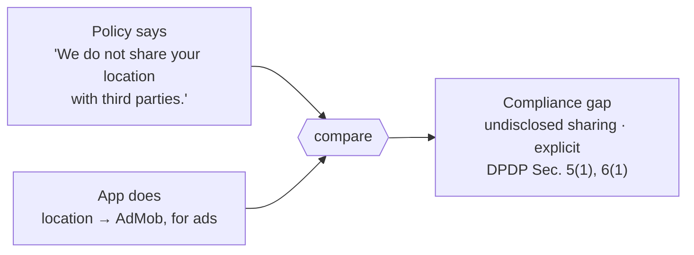

# Getting started: the problem and the concepts

This guide assumes no prior knowledge. After reading it you can follow every other page.

## 1. The problem

Apps publish a **privacy policy** saying what personal data they collect, why, and who receives it.
What an app *actually* does depends on its code and on the third-party **SDKs** it includes (Google
AdMob for ads, Firebase for analytics, …), which often send data to their own companies. The two can
disagree:



India's **Digital Personal Data Protection (DPDP) Act, 2023** and the **DPDP Rules, 2025** make such
gaps matter. Organisations must give notice of what data they process and why, use it only for that
purpose, erase it when the purpose is served, and protect children's data. Checking an app by hand is
slow. Old rule-based tools miss what their patterns don't cover, and a single LLM prompt is
unreliable.

**Project goal:** find every gap between a policy and what an app does, state how serious it is,
support it with the policy's own words and the right DPDP section, and measure how well different
systems do this.

We report **compliance gaps, not legal violations**. Most obligations apply from May 2027, and legal
judgement is out of scope.

## 2. The DPDP sections we use

The units are split from the official Gazette texts (`data/dpdp/sections.jsonl`, 153 units).

| Unit | Requirement | Gap types |
|---|---|---|
| Sec. 5(1) | Notice of the personal data processed and the purpose | collection, sharing, purpose |
| Sec. 6(1) | Consent is specific and limited to that purpose | collection, sharing, purpose |
| Rule 3 | The notice gives "an itemised description of such personal data" and the specified purpose | why vague wording is a gap |
| Sec. 8(7), Rule 8, Third Schedule | Erase data when the purpose is no longer served | retention |
| Sec. 9(3), Rule 10 | No tracking or targeted advertising directed at children; verifiable parental consent | children's data |

## 3. Data flows

A **data flow** describes one thing an app does with personal data:

```
data type  →  recipient     →  purpose      →  retention
Location   →  admob          →  Advertising  →  Unspecified
Contact    →  first_party    →  Marketing    →  Unspecified
```

- **Collection:** the recipient is `first_party` (the app's own company).
- **Sharing:** the recipient is a third-party SDK.

## 4. OPP-115

OPP-115 is a public research corpus of **115 website privacy policies**. Law students annotated every
data practice, paragraph by paragraph, for example:

```
category: Third Party Sharing/Collection · data type: Location · does/does not: Does Not
third party: Unnamed third party · purpose: Unspecified
```

We use the consolidated annotations (19,720 practices) and split by policy:
- **80 policies** for training the clause tagger;
- **35 held-out policies** for every test case (`data/splits.json`).

## 5. Test cases ("fake apps")

A test case is **not a working app**. It is a privacy policy plus three short text files that describe
an app: SDK dependencies (`build.gradle`), permissions (`AndroidManifest.xml`) and data flows
(`dataflows.json`). A script writes them in seconds. Systems read these files next to the policy;
nothing is installed or run.

For each held-out policy the script makes:
- one **compliant control**, which only does what the policy clearly allows;
- two **variants**, each with 1–2 planted flows that the policy does not properly allow.

Every case has an **answer key** computed by fixed rules from the expert annotations.

## 6. Gap types, levels and labels

| Gap type | The app… |
|---|---|
| Undisclosed collection | collects a data type the policy does not cover |
| Undisclosed sharing | sends a data type to a third party the policy does not cover |
| Purpose mismatch | uses data for a purpose not stated for it |
| Retention mismatch | keeps data indefinitely when the policy limits retention |
| Children's data | is child-directed and sends data to an ad or tracking SDK |

Each gap has a **level**, and each flow a matching **disclosure label**:

| Level | Policy wording for "location sent to an ad SDK" | Flow label |
|---|---|---|
| explicit | "We do not share your location." | incorrect |
| vague | "We may share information with partners." | vague |
| omission | location is never mentioned | omitted |
| no gap | "We share your precise location with Google AdMob for ads." | clear |

The existing tools (PoliCheck, PoliGraph) treat *vague* as acceptable. We treat it as a gap, because
of Rule 3, and we score the tools both ways.

## 7. Systems compared

| Family | Systems |
|---|---|
| Existing tools | S1 PoliCheck, S2 PoliGraph |
| Single-pass LLM | B1 (raw files), B2 (parsed facts + DPDP text), B4 (B2's prompt on Gemini) |
| Our pipeline | DPDP-Audit (full) and ablations A1–A5 |
| Clause-tagging components | S3 PrivBERT, S4 PolicyLint / PoliGraph extraction, B3 prompted 3B tagger, our QLoRA tagger |

## 8. Metrics

- **Precision:** the share of reported gaps that are real.
- **Recall:** the share of real gaps that were found.
- **F1:** their balance.
- **False-alarm rate:** the share of compliant apps where a system reports any gap (lower is better).
- **Citation correctness:** the share of correct findings citing an accepted DPDP section.
- **Label macro-F1:** how well flows are labelled clear / vague / omitted / incorrect.
- **95% interval:** a range made by re-sampling whole policies.
- **R@95:** how much of a system's output a human must review before the rest is 95% accurate.

## 9. Where to go next

| You want to… | Read |
|---|---|
| See how the system fits together | [architecture.md](architecture.md) |
| Understand case generation and answer keys | [benchmark.md](benchmark.md) |
| Understand our pipeline | [pipeline.md](pipeline.md) |
| Set up your laptop and work on the code | [developer-guide.md](developer-guide.md) |
| Re-run everything | [reproduction.md](reproduction.md) |
| See current results | [stage-1-report.md](stage-1-report.md) |
| See the schedule and who does what | [plan.md](../plan.md) |
