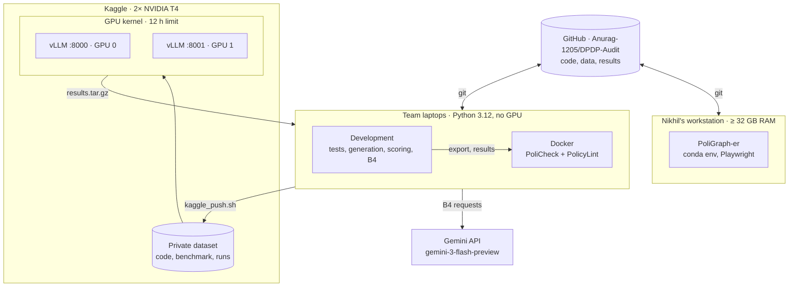
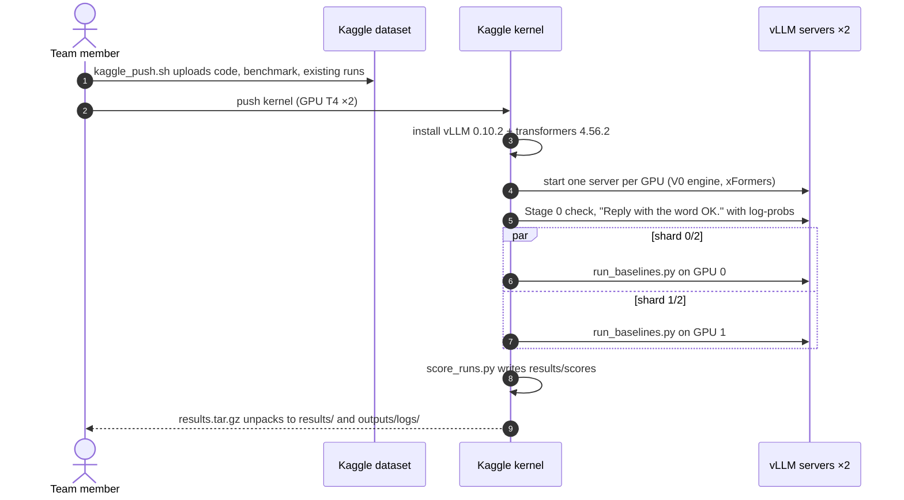
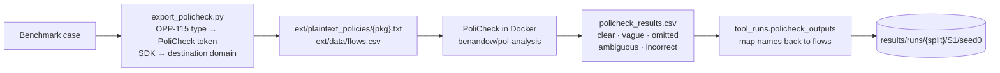

# Infrastructure

## Deployment view

| Environment | Used for | Key versions |
|---|---|---|
| Laptop | Everything without a GPU | Python 3.12, `pip install -e .`, Docker |
| PoliCheck image `benandow/pol-analysis` | S1 and S4 (PolicyLint) | Python 2.7, spaCy 2.0.12, `en_core_web_lg` 2.0.0, authors' `NlpFinalModel` |
| Kaggle kernel | Qwen inference (B1, B2, full, ablations), QLoRA and PrivBERT training | Python 3.13, vLLM 0.10.2, transformers 4.56.2, PyTorch 2.8.0 + CUDA 12.8 |
| Nikhil's workstation | S2 PoliGraph and its extraction (S4) | PoliGraph conda env, ≥ 32 GB RAM, GPU optional |
| Gemini API | B4 | `gemini-3-flash-preview`, free tier. The proposal's "Gemini 3.5 Flash" is not available to the team's key; this model returned valid JSON in tests |

## Kaggle job

### Why vLLM 0.10.2

| vLLM | Result on Kaggle T4 |
|---|---|
| 0.6.3 | Does not install: Kaggle moved to Python 3.13 / PyTorch ≥ 2.5 |
| 0.32 (latest) | Pulls a CUDA 13 PyTorch that conflicts with Kaggle's `torchaudio` |
| 0.11.0 | Runs, but T4 GPUs have no FlashAttention and the V1 engine falls back to FlexAttention: one 12-hour session finished only 291 of 612 runs |
| **0.10.2**, V0 engine + xFormers | All 612 runs in about 35 minutes |

Operational rules:
- **Pinned engine:** pin vLLM 0.10.2 with the V0 engine and xFormers. Newer releases fall back to
  FlexAttention on T4 GPUs, which is about 10× slower.
- **Ordering and recovery:** jobs run seed-first, resume from saved runs (`--redo-failed`), stop
  starting work at 10 hours, and always pack their results.
- **Mounting delay:** after uploading a new dataset version, wait about 4 minutes before pushing the
  kernel (`kaggle_push.sh` does this). Otherwise the kernel may mount the previous version.
- **Measured throughput:** 612 single-call runs in about 35 minutes, including about 6.5 minutes of
  server start-up.

## PoliCheck adapter (S1)

- **Input:** one plaintext policy per package, plus `flows.csv` with the columns `package_name,
  app_name, version_name, version_code, data_type, dest_domain, dest_ip, arb_number,
  privacy_policy`.
- **Output:** PoliCheck reports data by ontology terms ("email address", "advertising identifier") and
  recipients by entity ("we" for the first party, e.g. "google ads"). The adapter matches rows on
  (package, data term, first party or not).
- **Setup:** `scripts/tools/setup_policheck.sh` does three things:
  - removes the archived-Debian `apt-get` lines from the 2020 Dockerfile;
  - installs the 852 MB spaCy model from a host-downloaded file;
  - fetches the authors' NLP model from Google Drive.
- **Real-flow data:** the authors' repository ships about 186k real network flows with policy URLs
  (`ext/data/flows.csv`). SPEC-08 samples these flows.

## PoliGraph adapter (S2)

- **Environment:** runs on Nikhil's workstation (≥ 32 GB RAM) with
  `scripts/tools/run_poligraph.sh <export dir>`. The script:
  - creates the authors' conda environment;
  - installs Playwright Chromium;
  - downloads the extra data;
  - wraps each plaintext policy as HTML;
  - builds the knowledge graphs;
  - runs the authors' flow-consistency check on the same PoliCheck-format `flows.csv`.
- **Output:** `results/tools/poligraph/{split}/poligraph_results.csv`. Scratch files go to
  `outputs/poligraph/{split}/`.
- **Released version:** only the NLP version of PoliGraph-er; the LLM variant described in the
  extended paper is not in the repository.

## Compute budget

| Workload | Runs | Estimated GPU time | Where |
|---|---|---|---|
| B1/B2, main, 3 seeds | 612 | 0.6 h (measured) | Kaggle 2× T4 |
| B2, ladder, 3 seeds | 420 | ≈ 0.5 h | Kaggle |
| DPDP-Audit, main, 3 seeds | 306 | ≈ 4–6 h (~10–15 calls per run) | Kaggle |
| DPDP-Audit, ladder, 3 seeds | 420 | ≈ 5–8 h | Kaggle |
| Ablations A1–A5, main, 1 seed | 510 | ≈ 6–9 h | Kaggle |
| QLoRA tagger (2 epochs) + B3 | — | ≈ 6–10 h | Kaggle T4 |
| PrivBERT fine-tuning | — | ≈ 1–2 h | Kaggle T4 |
| B4 Gemini, main, 3 seeds | 306 | API (rate-limited) | Gemini free tier |
| PoliCheck, main + ladder | 242 cases | CPU | Laptop (Docker) |
| PoliGraph, main + ladder | 242 cases | CPU / optional GPU | Nikhil's workstation |

Kaggle gives each account a weekly GPU quota (about 30 hours). Training and inference are spread over
the members' accounts (see `plan.md`). The pipeline estimates are confirmed by the 5-case pilot.

## Configuration and secrets

| Variable | Used by | Notes |
|---|---|---|
| `GEMINI_API_KEY`, `GEMINI_MODEL` | B4, Gemini fallback | in `.env` (git-ignored); template in `.env.example` |
| `LLM_BACKEND` | all LLM systems | `openai` (vLLM) or `gemini` |
| `OPENAI_BASE_URL`, `OPENAI_MODEL`, `OPENAI_TIMEOUT` | vLLM backend | set by the Kaggle kernel; timeout 1,800 s |
| `~/.kaggle/kaggle.json` | Kaggle CLI | per user, outside the repository |

Secrets are never committed. `.env` and `outputs/` are ignored, and the Kaggle dataset bundle has an
explicit file list in `scripts/kaggle_push.sh`.
