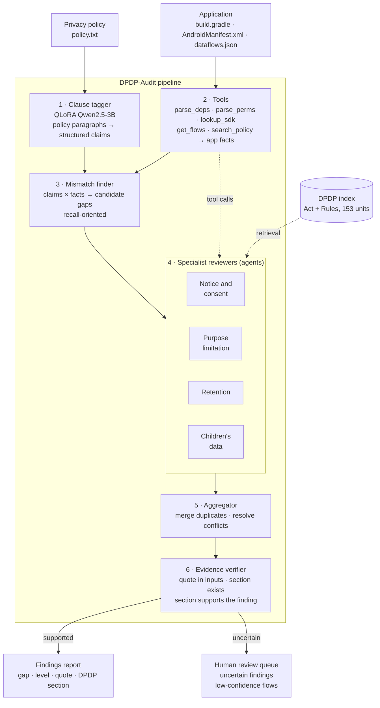
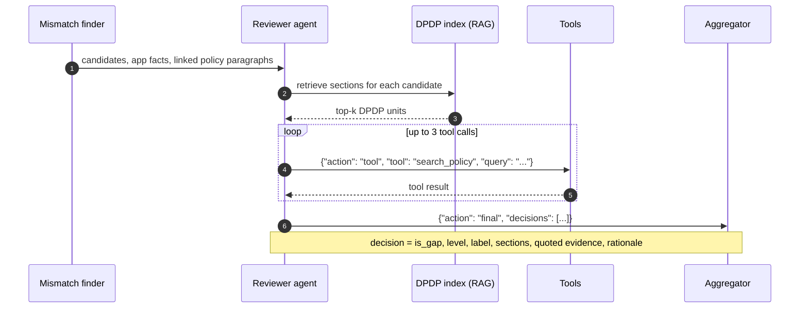
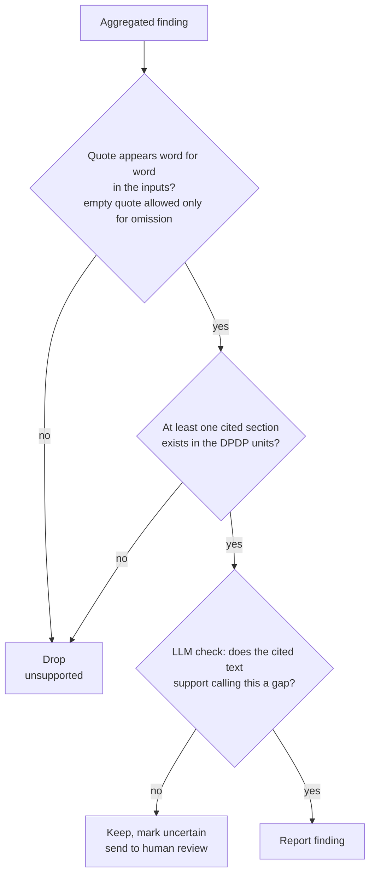

# DPDP-Audit pipeline

**Status:** v1 implemented (SPEC-04) in `src/dpdp_audit/pipeline/`, with unit tests on a scripted fake
LLM (`tests/test_pipeline.py`). Runs: `scripts/run_pipeline.py` locally or `kaggle/pipeline/` on Kaggle.

The pipeline takes a privacy policy and an application, and returns findings. Each finding has a gap
type, a level, a verbatim quote from the policy and a DPDP section. A finding without evidence is
never reported. Uncertain findings go to human review.

## End-to-end flow

## Stages and data contracts

| # | Stage | Input | Output | Course capability |
|---|---|---|---|---|
| 1 | Clause tagger | Policy paragraphs | Claims: `{paragraph, category, data_type, does, third_party, third_party_text, purpose, retention, audience}` | Fine-tuning |
| 2 | Tools | App folder | Facts: SDKs found, permissions → data types, `child_directed`, flows | Tool calling |
| 3 | Mismatch finder | Claims + facts | Candidates: `{candidate_id, flow_id, data_type, recipient, purpose, retention, gap_type, reason}` | Reasoning |
| 4 | Specialist reviewers | Candidates of their gap types, linked paragraphs, retrieved DPDP units | Decisions: `{candidate_id, is_gap, level, label, sections, evidence, rationale}` | Agents + RAG |
| 5 | Aggregator | All decisions | Findings (one per data type × gap type) + one disclosure label per flow | Agents |
| 6 | Evidence verifier | Findings + policy text | Findings with `supported`, `uncertain`; a confidence per flow | Reasoning |

Reviewer responsibilities:

| Reviewer | Gap types | DPDP focus |
|---|---|---|
| Notice and consent | undisclosed collection, undisclosed sharing | Sec. 5, Sec. 6, Rule 3 |
| Purpose limitation | purpose mismatch | Sec. 5(1), Sec. 6(1) |
| Retention | retention mismatch | Sec. 8(7), Rule 8, Third Schedule |
| Children's data | children's data | Sec. 9, Rule 10 |

Every model call goes through the cached LLM client: Qwen2.5-7B-Instruct served by vLLM on Kaggle, or
Gemini for B4 only. The pipeline and the single-pass baselines B1/B2 use **the same model**.

## Implementation

| Stage | Module | Notes |
|---|---|---|
| 1 Tagger | `pipeline/claims.py`, `scripts/tag_policies.py` | Taggers run offline, once per distinct paragraph (keyed by a hash of its text), and write `results/tagger/claims/<tagger>.jsonl`. `oracle` is built from the OPP-115 annotations. |
| 2 Tools | `baselines.app_facts`, `tools/` | The same parsed facts B2 receives |
| 3 Mismatch finder | `pipeline/finder.py` | Deterministic. A flow is a candidate unless the claims cover it explicitly and specifically; each candidate carries a suggested level, a reason and linked paragraph numbers |
| 4 Reviewers | `pipeline/reviewers.py`, `pipeline/decide.py`, `pipeline/vocab.py` | One LLM agent per reviewer with candidates; it copies the policy sentences that disclose, deny or generically cover each flow, and `decide.py` derives the decision from the quotes that are in the policy. Tool loop of at most 3 calls; prompts fill a 30,000-character budget (≈ 8.5k tokens) so a reply always fits the 12,288-token context |
| 5 Aggregator | `pipeline/aggregator.py` | Normalises citations, drops a purpose finding when the same flow has a notice gap, merges findings per (data type, gap type); an undecided candidate keeps the finder's label |
| 6 Verifier | `pipeline/verifier.py` | Deterministic quote and section checks, then one LLM support check per case (temperature 0); a reply that cannot be parsed leaves the findings as they are (logged) |
| Configurations | `pipeline/config.py` | `full`, `A1`–`A5`, `full_finetuned` |

Every run stores a `trace`: paragraphs and claims, candidates, reviewer decisions, tool calls with their
validity, undecided candidates, LLM calls and seconds. Dropped findings are kept under `dropped` with
the reason.

**What the oracle ablation measures.** The answer keys are computed from the same annotations the
oracle tagger reads, and the finder applies the same notion of coverage. With oracle claims the
finder's candidates reproduce the keys (checked on the dev split: 35 of 35 gold gaps found at the right
level, no candidate on a control). A5 is therefore an upper bound on what the reviewers keep, not an
independent measurement; the A4–A5 gap is the cost of reading errors.

**Development split.** Prompts were developed on `data/benchmark/dev/` (33 cases, 11 controls, from
12 *training* policies; `scripts/generate_cases.py --split dev --policy-set train --n-policies 12`),
never on the evaluation cases. Four iterations, seed 0, prompted tagger (runs kept under
`results/runs/dev/full_dev1…3` and `full`):

| Run | Change | F1 | False-alarm rate |
|---|---|---|---|
| dev1 | first version: reviewers decide `is_gap` | 0.195 | 0.64 |
| dev2 | glossary of OPP-115 data types and purposes; everyday words in searches; near-verbatim quotes snapped | 0.241 | 0.91 |
| dev3 | reviewers extract quotes, `pipeline/decide.py` derives the decision; finder's suggested level hidden | 0.372 | 0.36 |
| dev4 | a positive quote naming the data type counts as disclosure in any slot | 0.361 | 0.36 |

The prompts and rules were frozen after dev4 (26 Oct) and only then run on the main benchmark and
the ladder. What dev showed: a 7B reviewer asked "is this a gap?" agrees with almost every
candidate; asked to copy the sentence that discloses the flow, it is far more reliable, and a
deterministic rule over verified quotes makes the decision. Purpose mismatches stayed undetected
on dev (0 of 8).

### Decision rules (`pipeline/decide.py`)

| Gap type | No gap | explicit | vague | omission |
|---|---|---|---|---|
| Collection / sharing | a verified positive quote naming the data type (sharing: and the SDK or its company) | a verified denial naming the data type, with no positive quote | a verified generic quote, or a sharing quote without the recipient | nothing verified |
| Purpose | a verified quote giving the app's purpose for the data type | — | the data type appears only without a purpose (verified quote) | otherwise |
| Retention | the policy keeps data indefinitely | a stated period or limit | retention mentioned without a period | nothing about retention |
| Children | — (always a gap for a child-directed app sending data to an ad/tracking SDK) | a verified children statement | — | no children statement |

## v2

The first evaluation runs showed problems (the verifier's LLM check rejects correct findings, purpose
gaps are rarely found). Looking at main-benchmark errors would be tuning on evaluation cases, so v2
was developed on training policies only, and every change is a switch of `pipeline/config.py`: the
frozen `full` and `full_finetuned` runs are unchanged and stay in every table.

**Dev splits.** `dev` (33 cases) plus a new `dev2` (69 cases from 23 more training policies;
`scripts/generate_cases.py --split dev2 --policy-set train --n-policies 24 --exclude-splits dev`), 102
cases from 34 policies with 118 gold gaps, about the size of main. No policy is shared with dev, main
or the ladder. The fine-tuned tagger was trained on all training policies, so the dev splits are only
fair to the prompted tagger; every choice below was made with it.

**What the dev analysis found.**
- The LLM check rejected every correct children's-data and retention finding on dev; it is right to
  reject most collection and purpose findings.
- 7 of the 8 dev purpose gaps were never checked: the tagger missed the collection claim, so the
  finder proposed a collection gap instead of checking the purpose.
- A purpose quote such as "this information is used to ..." was rejected because the sentence itself
  does not name the data type.
- 17 of 47 false collection findings had the disclosing paragraph cut by the 8-paragraph limit; in
  most of the others the paragraph was shown but the reviewer, answering several candidates at once,
  quoted nothing.
- The retention reviewer echoes the app's own "Indefinitely" and, with more paragraphs, quotes an
  unrelated sentence, which the frozen rule reads as "the policy keeps data indefinitely, no gap".

**Variants** (seed 0, prompted tagger; runs under `results/runs/dev*/v2_*`):

| Config | Change | F1 | False-alarm rate | Label macro-F1 |
|---|---|---|---|---|
| full (frozen) | — | 0.322 | 0.41 | 0.308 |
| v2_gate | LLM check only on collection and purpose findings; a purpose quote counts if its paragraph names the data type | 0.527 | 0.41 | 0.308 |
| v2_read | + up to 16 paragraphs per reviewer; purpose searches with the purpose's everyday words (4 hits) | 0.524 | 0.35 | 0.318 |
| v2_purpose | + a purpose candidate for every flow whose notice is in doubt | 0.458 | 0.59 | 0.379 |
| v2_batch | v2_read + one candidate per reviewer call | 0.548 | 0.29 | 0.382 |
| **full_v2** | v2_batch + a retention quote must be about keeping data, and "indefinitely" must be in it | **0.623** | **0.29** | **0.382** |

full_v2's row re-derives v2_batch's saved replies with the retention rule (the rule is deterministic;
re-deriving with the rule off reproduces v2_batch exactly). Paired policy-level bootstrap on the
pooled dev splits: full_v2 − full: F1 **+0.301 [+0.229, +0.392]**, false-alarm rate −0.118
[−0.324, +0.088], label macro-F1 **+0.074 [+0.005, +0.150]**. v2_purpose was rejected (F1 −0.066
[−0.112, −0.025], false alarms +0.235 [+0.029, +0.441] vs v2_read).

**Frozen 27 Oct** as `full_v2` (prompted tagger) and `full_v2_finetuned`, before any v2 run on main or
the ladder. The dev numbers above were measured with the frozen verifier reader (see
[Evidence verifier](#evidence-verifier)); re-verified with the robust reader the ranking is the same
(pooled dev F1: `full` 0.19, `v2_purpose` 0.53, `v2_read` 0.58, `v2_gate` 0.59, `v2_batch` 0.60,
`full_v2` 0.68). The tool-calling problem (no reviewer calls a tool) is not addressed: the finder already
runs `search_policy` for every candidate, and showing more paragraphs covers what the calls would add.

## Reviewer agent loop

Rules for the loop:
- Only `search_policy`, `retrieve_dpdp` and `lookup_sdk` exist.
- Unknown tools return an error message.
- A reply that is not JSON ends the loop with no decisions.
- Tool-call validity is logged for the tool-calling evaluation.

## Evidence verifier

Section names are normalised before the check. For example, "Section 8(7)" becomes `Sec. 8(7)`, and
"Article 6 GDPR" is rejected.

**Reply bug (found 28 Oct) and the robust reader.** The LLM check asks for all of a case's checked
findings in one reply. The 7B model often writes one `{"checks": [...]}` object per finding; the frozen
reader parsed from the first `{` to the last `}`, failed, and kept every finding unchecked. This hit
38% of `full` runs and 15–20% of v2 runs on main. `parse_checks` (used by every `*_rv` configuration)
parses normally, then removes invalid escapes, then recovers every complete `finding_id`/`supported`
pair; it stores the raw reply whenever normal parsing fails and counts findings left without a verdict
(`verifier_parse`, `verifier_raw`, `verifier_unchecked` in the trace). `scripts/reverify.py` re-runs only
the verifier on saved runs, so `X_rv` differs from `X` only in the verifier. After the fix: 0 unreadable
replies in 2,346 runs, 14 findings without a verdict.

## Confidence per flow

Each LLM system runs with seeds 0, 1 and 2. For each flow:
- **label:** the majority label over the three seeds;
- **confidence:** the share of seeds that agree, with the mean token probability of the final answer
  (from vLLM log-probabilities) as a tie-break.

This orders the human-review queue and drives selective accuracy
([evaluation.md](evaluation.md#selective-accuracy)).

## Ablations

Each ablation is a configuration switch, not a copy of the code.

| ID | Change | Question it answers |
|---|---|---|
| full | Fine-tuned tagger, 4 reviewers, aggregator, RAG, verifier | — |
| A1 | Verifier off | How much does evidence gating cut false alarms? |
| A2 | No DPDP retrieval | How much does legal grounding help citations? |
| A3 | One generalist reviewer, no aggregator | Do specialist agents and aggregation help? |
| A4 | Prompted 3B tagger instead of fine-tuned | What does fine-tuning add end to end? |
| A5 | Oracle tagger (gold OPP-115 annotations) | How much error is reading the policy vs legal reasoning? |

The full system uses the prompted tagger until the fine-tuned tagger passes its acceptance criteria
(SPEC-05). The oracle tagger only applies to unmodified OPP-115 policies, so it is not used on the
ladder.
