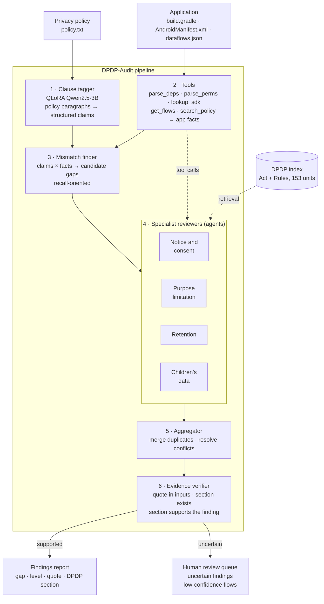
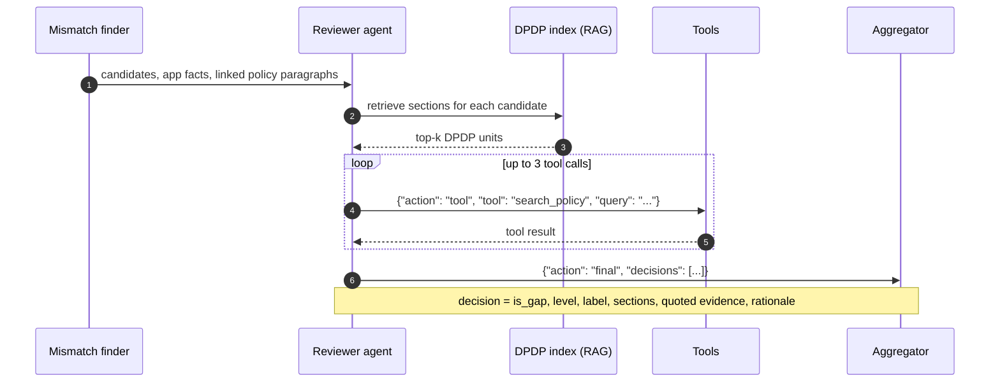
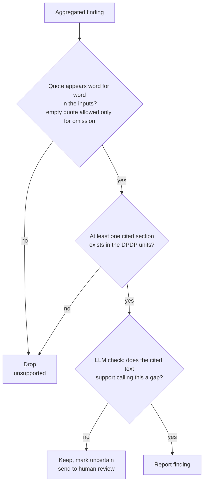

# DPDP-Audit pipeline

**Status:** planned (SPEC-04). The shared services it uses (app tools, DPDP retrieval, LLM client) are
implemented.

The pipeline takes a privacy policy and an application, and returns findings. Each finding has a gap
type, a level, a verbatim quote from the policy and a DPDP section. A finding without evidence is
never reported. Uncertain findings go to human review.

## End-to-end flow

## Stages and data contracts

| # | Stage | Input | Output | Course capability |
|---|---|---|---|---|
| 1 | Clause tagger | Policy paragraphs | Claims: `{paragraph, category, data_type, does, third_party, third_party_text, purpose, retention, audience}` | Fine-tuning |
| 2 | Tools | App folder | Facts: SDKs found, permissions → data types, `child_directed`, flows | Tool calling |
| 3 | Mismatch finder | Claims + facts | Candidates: `{candidate_id, flow_id, data_type, recipient, purpose, retention, gap_type, reason}` | Reasoning |
| 4 | Specialist reviewers | Candidates of their gap types, linked paragraphs, retrieved DPDP units | Decisions: `{candidate_id, is_gap, level, label, sections, evidence, rationale}` | Agents + RAG |
| 5 | Aggregator | All decisions | Findings (one per data type × gap type) + one disclosure label per flow | Agents |
| 6 | Evidence verifier | Findings + policy text | Findings with `supported`, `uncertain`; a confidence per flow | Reasoning |

Reviewer responsibilities:

| Reviewer | Gap types | DPDP focus |
|---|---|---|
| Notice and consent | undisclosed collection, undisclosed sharing | Sec. 5, Sec. 6, Rule 3 |
| Purpose limitation | purpose mismatch | Sec. 5(1), Sec. 6(1) |
| Retention | retention mismatch | Sec. 8(7), Rule 8, Third Schedule |
| Children's data | children's data | Sec. 9, Rule 10 |

Every model call goes through the cached LLM client: Qwen2.5-7B-Instruct served by vLLM on Kaggle, or
Gemini for B4 only. The pipeline and the single-pass baselines B1/B2 use **the same model**.

## Reviewer agent loop

Rules for the loop:
- Only `search_policy`, `retrieve_dpdp` and `lookup_sdk` exist.
- Unknown tools return an error message.
- A reply that is not JSON ends the loop with no decisions.
- Tool-call validity is logged for the tool-calling evaluation.

## Evidence verifier

Section names are normalised before the check. For example, "Section 8(7)" becomes `Sec. 8(7)`, and
"Article 6 GDPR" is rejected.

## Confidence per flow

Each LLM system runs with seeds 0, 1 and 2. For each flow:
- **label:** the majority label over the three seeds;
- **confidence:** the share of seeds that agree, with the mean token probability of the final answer
  (from vLLM log-probabilities) as a tie-break.

This orders the human-review queue and drives selective accuracy
([evaluation.md](evaluation.md#selective-accuracy)).

## Ablations

Each ablation is a configuration switch, not a copy of the code.

| ID | Change | Question it answers |
|---|---|---|
| full | Fine-tuned tagger, 4 reviewers, aggregator, RAG, verifier | — |
| A1 | Verifier off | How much does evidence gating cut false alarms? |
| A2 | No DPDP retrieval | How much does legal grounding help citations? |
| A3 | One generalist reviewer, no aggregator | Do specialist agents and aggregation help? |
| A4 | Prompted 3B tagger instead of fine-tuned | What does fine-tuning add end to end? |
| A5 | Oracle tagger (gold OPP-115 annotations) | How much error is reading the policy vs legal reasoning? |

The full system uses the prompted tagger until the fine-tuned tagger passes its acceptance criteria
(SPEC-05). The oracle tagger only applies to unmodified OPP-115 policies, so it is not used on the
ladder.
