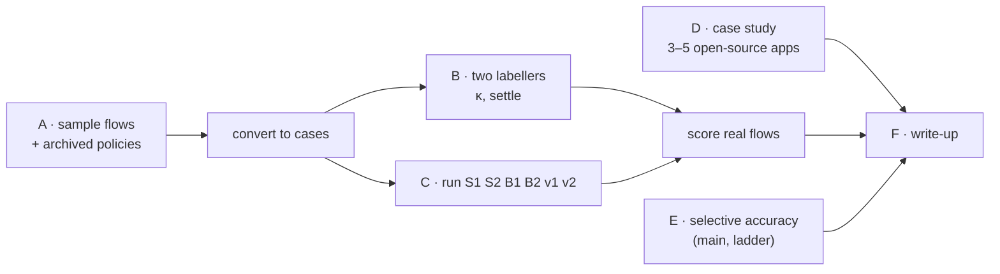
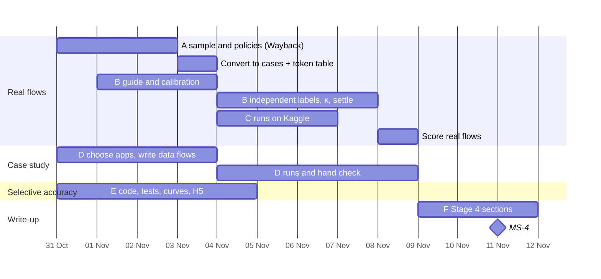

# Stage 4 — implementation plan (MS-4, evaluation complete)

- **Branch:** `stage-4` (from `main` after PR #4)
- **Window:** 31 Oct – 11 Nov 2026 (MS-4 due 11 Nov; final submission 15 Nov)
- **Covers:** SPEC-07 (selective accuracy), SPEC-08 (real flows and case study), the open real-flow
  items of SPEC-02 (AC-02.9) and SPEC-03
- **Rules that still hold:** no LLM in ground truth; no tuning on evaluation cases (the real flows and
  the case study are evaluation data: every configuration is run as frozen); free compute only;
  every result regenerated by a recorded command.

## 1. What Stage 4 has to deliver

| Part | Spec | Owner (plan §5) | Output |
|---|---|---|---|
| A. Real-flow sample | SPEC-08, AC-08.1 | Anurag | `data/real_flows/sample.csv`, archived policies |
| B. Real-flow labels | AC-08.2 | Anurag + Ishaan | two independent label sheets, κ, settled labels |
| C. Real-flow runs and scores | AC-08.3, AC-02.9 | Ishaan | `results/runs/real_flows/`, `results/scores/real_flows.json` |
| D. Open-source case study | AC-08.4 | Naveen | `data/case_study/`, hand-checked findings |
| E. Selective accuracy | SPEC-07 | Nikhil | `results/scores/selective_{main,ladder}.json`, `results/figures/` |
| F. Write-up | SPEC-09 | All | Stage 4 sections of the final report |

E does not depend on A–D and starts at once. C's runs need A but not B, so they run while B is
being labelled; scoring waits for the settled labels.

## 2. Part A — real-flow sample (SPEC-08, AC-08.1)

**Source.** PoliCheck's released flows (`ext/data/flows.csv`: 186,578 flows from 22,422 apps, no
header; columns package, app name, version, version code, data token, destination domain, IP,
count, policy URL). Flows were captured about 2017–2019, so each policy is the Wayback Machine copy
closest to **15 Feb 2019** (the date PoliCheck's authors downloaded theirs) and inside
Jun 2018 – Dec 2019. Old flow + policy of the same time is the fair pair; a current policy is not.

**Start from the existing sampler.** `scripts/tools/policheck_repro_sample.py` (in
`stash@{0}`, recovered on this branch) already does this: random apps (seed 13), one Wayback request
at a time with retry on 429, filters for English and minimum length. It has tried 51 apps; 15
policies are usable (~30%).

| Step | Work | Done when |
|---|---|---|
| A1 | Restore the sampler from `stash@{0}`; move its output from `data/policheck_repro/` to `data/real_flows/` | Script runs on the branch and resumes from `progress.jsonl` |
| A2 | Run it to **≥ 25 usable apps** (≈ 85 apps tried at 30%) | 25+ policies in `data/real_flows/policies/` |
| A3 | Clean each policy to plain text with paragraphs kept (blank line between blocks), since `search_policy` and the tagger split on blank lines | Spot-read 5 policies: no menus, cookie banners or footers |
| A4 | Pick **60–80 flows**: per app at most 4, distinct (data type, destination); stratify so Location and Contact appear (the data is 50% `aaid`, 24% `androidid`) and first-party flows are kept (~6% of all flows) | `sample.csv` with 60–80 rows, data-type and recipient mix recorded |
| A5 | Write `data/real_flows/README.md`: source, dates, filters, yield, and the failure rule below | — |

**Token → data type** (new frozen table `data/tools/real_token_mapping.csv`, agreed by the team
before any run, constraint 2 in specs):

| PoliCheck token | Benchmark data type | Note |
|---|---|---|
| `aaid`, `androidid`, `imei`, `hwid`, `gsfid`, `simid`, `wifimac` | IP address and device IDs | |
| `geolatlon` | Location | exact |
| `email`, `phone` | Contact | |
| `routerssid`, `routermac`, `fingerprint`, anything else | excluded from the sample | Wi-Fi name, router MAC and build fingerprint have no clear data type (location proxy? device ID?); left out so labellers and systems are not judged on a debatable mapping |

**Destination → recipient:** a domain of the app's own company is `first_party`; a domain in
`data/tools/sdk_domains.csv` is that SDK; any other domain is resolved by hand in A4 or the flow is
dropped. Purpose and retention are unknown for real traffic, so real flows test **collection and
sharing only** (the *common* view), not purpose, retention or children's data.

**Failure rule (AC-08.5).** If fewer than 20 usable apps after 120 tried, stop: the case study
becomes the real-data result, and the yield is reported.

## 3. Convert the sample to benchmark cases

New `scripts/build_real_flows.py` writes `data/benchmark/real_flows/` in the same layout as `main`,
so every existing runner and `score_runs.py --split real_flows` works unchanged:

- `cases/<package>/policy.txt`, `meta.json` (`kind: "real"`, policy URL, snapshot date);
- `cases/<package>/app/dataflows.json` with `data_type`, `recipient`, `purpose: "Unspecified"`,
  `retention: "Unspecified"`; `build.gradle` listing the SDKs the destinations imply;
- `export/policheck/` (flows.csv, flow_index.csv, plaintext policies) for S1 and S2, as for
  `data/tools/policheck_sanity/`;
- `answer_keys/` written only from the **settled human labels** (Part B), never by a script.

Tests: the converter on two hand-made apps; every flow in `sample.csv` appears once in a case.

## 4. Part B — two-person labels (AC-08.2)

The ladder check reached κ = 0.19 and the spot-check κ = 0.04, mostly from unclear rules. So labelling
starts with a guide and a calibration round:

| Step | Work | Done when |
|---|---|---|
| B1 | `docs/real-flow-labelling.md`: the four labels (clear / vague / omitted / incorrect, with ambiguous counted as incorrect, as in `tool_runs.py`), the gap type (collection or sharing), and 2 worked examples per label from the ladder templates | Guide reviewed by both labellers |
| B2 | Calibration: both label the same 8 flows (not in the sample), compare, fix the guide | Disagreements on the 8 explained in the guide |
| B3 | Independent labelling of all 60–80 flows into two sheets. Labellers do **not** see any system output (the runs stay in an unopened folder until B4) | Two complete sheets |
| B4 | Cohen's κ per label and per gap type; settle every disagreement together, recording the reason, as in `docs/manual-checks.md` | `sample.csv` with both labels, the settled label and κ |

## 5. Part C — runs and scores (AC-08.3, AC-02.9)

All on Kaggle under one account, as frozen, no prompt or threshold changes.

| System | Seeds | Job | Notes |
|---|---|---|---|
| S1 PoliCheck | 1 | `kaggle/policheck`, `SPLIT = "real_flows"` | first add `real_flows` to the export path in `run.py` |
| S2 PoliGraph | 1 | `kaggle/poligraph` | |
| B1, B2 | 3 | `kaggle_push.sh` (B1/B2 kernel) | |
| v2 `full_v2_finetuned` (the system) | 3 | `kaggle/pipeline` | main configuration |
| v2 `full_v2`, v1 `full_finetuned` | 3 | `kaggle/pipeline` | for the record, if GPU quota allows |

Cost estimate: ~25 cases × 3 seeds × ~80 s ≈ 1.7 GPU-hours per pipeline configuration, well inside
the 30 h weekly Kaggle quota. B4 (Gemini) is optional: 25 requests per seed fit the free tier.

**Scoring** (`score_runs.py --split real_flows`, added to `scripts/score_all.sh`):
- flow-label accuracy and macro-F1 against the settled labels (the main real-flow number);
- gap detection P / R / F1 in the common and common-native views;
- per-flow false alarms: share of flows labelled *clear* that a system reports as a gap (real data
  has no control apps, so the case-level false-alarm rate is not defined);
- 95% intervals by app-level bootstrap, and the agreement of each system with each labeller, to set
  it against the human κ.

## 6. Part D — open-source case study (AC-08.4)

| Step | Work | Done when |
|---|---|---|
| D1 | Choose 3–5 open-source Android apps with their own policy, including at least one Indian app for the DPDP angle. Candidates: Aarogya Setu (`nic-delhi/AarogyaSetu_Android`), Wikipedia Android, K-9 Mail, an F-Droid app with analytics. Freeze the commit hash and the policy date | List with repo, commit, policy URL |
| D2 | Per app, read the code and write `dataflows.json` and `build.gradle` by hand: data type, recipient (from SDK init calls and endpoints), purpose and retention where the code shows them | Each flow cites a file and line |
| D3 | Convert to `data/case_study/` in the case layout; run `full_v2_finetuned` (3 seeds) and B2 | Runs saved |
| D4 | Check every finding by hand against the policy and the code: correct / wrong / uncertain, with a reason | Table per app; qualitative write-up, no statistics |

This is the only part with current code, current policies and an Indian app, so it covers what the
2019 data cannot.

## 7. Part E — selective accuracy (SPEC-07, H5)

Input: `results/confidence/{main,ladder}.json` (already exported, AC-04.13). It holds B1, B2, B4,
`full`, `full_finetuned`, `full_v2`, `full_v2_finetuned`, S1 and S2 on main, and the same minus B1/B4
on the ladder. Flow labels come from the reviewers, so the `_rv` verifier fix does not change them.

| Step | Work | AC |
|---|---|---|
| E1 | `src/dpdp_audit/selective.py`: flows sorted by increasing confidence (agreement, then token probability); reviewed flows take the gold label; accuracy of the unreviewed flows vs share reviewed (0–100%) | 07.1, 07.2 |
| E2 | Metrics: area under the curve, R@95 (review needed for 95% accuracy), review needed to match the best tool | 07.3 |
| E3 | S1, S2 as single points at 0% review; one-seed systems excluded; ties and missing flows as in `confidence.py`; B4 has no token probability (agreement only) | 07.4, 07.7 |
| E4 | R@95 with a 95% policy-level bootstrap interval | 07.6 |
| E5 | Ladder: paired comparison of confidence on explicit vs vague rungs (110 accepted rungs only) | 07.5 |
| E6 | Unit tests on a synthetic example with a known R@95; `scripts/selective_accuracy.py`, curves in `results/figures/`, added to `score_all.sh` | 07 evidence |

**H5 verdict:** holds if `full_v2_finetuned` (and v1 `full`, reported) needs less review than B2 for
95% accuracy with an interval excluding 0, and its confidence is lower on vague than on explicit rungs.

## 8. Schedule

| Date | Checkpoint |
|---|---|
| 2 Nov | ≥ 25 usable apps or the failure rule applied; token table agreed |
| 4 Nov | Selective accuracy curves and H5 verdict on main and ladder |
| 7 Nov | Labels settled with κ; all real-flow runs done; case-study data flows written |
| 9 Nov | Real-flow scores; case-study findings checked |
| 11 Nov | MS-4: Stage 4 sections drafted, `score_all.sh` regenerates every new score |

## 9. Risks

| Risk | Effect | Mitigation |
|---|---|---|
| Wayback yield stays ~30% and 429s slow it | Fewer than 25 apps | Start A2 first, run it unattended; failure rule in §2 |
| Policy pages extract badly (menus, banners) | Systems read noise | A3 spot-read; drop unreadable policies before labelling |
| Low κ again (ladder 0.19) | Weak ground truth | Guide + calibration round first (B1, B2); report κ honestly |
| Labellers see system outputs | Biased labels | Runs kept unopened until B4 is settled |
| Real flows only test collection/sharing | Narrower claim | State it; the case study covers purpose and retention |
| 2019, mostly non-Indian, pre-DPDP apps | External validity | State it; Indian app in the case study |
| Kaggle quota or a failed kernel | Delay | v2 finetuned first; other configurations only if quota allows |

## 10. Definition of done (MS-4)

- [ ] `data/real_flows/sample.csv`: 25+ apps, 60–80 flows, two labels, settled label, κ (AC-08.1, 08.2)
- [ ] `results/runs/real_flows/` for S1, S2, B1, B2 and `full_v2_finetuned`; `results/scores/real_flows.json` (AC-08.3, AC-02.9)
- [ ] `data/case_study/` with 3–5 apps and a hand-checked findings table (AC-08.4)
- [ ] `results/scores/selective_{main,ladder}.json`, curves, R@95 intervals, H5 verdict (AC-07.1–07.7)
- [ ] `scripts/score_all.sh` regenerates all of the above; tests pass
- [ ] SPEC-07 and SPEC-08 statuses and the plan's MS-4 row updated
