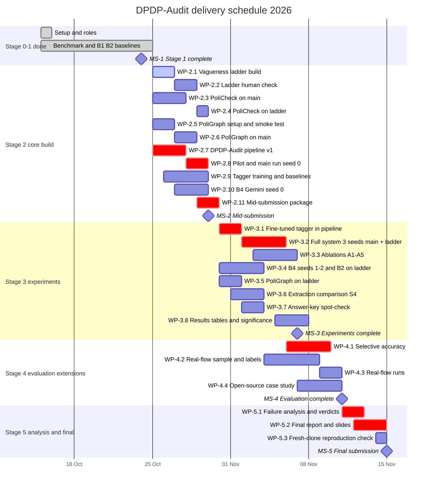
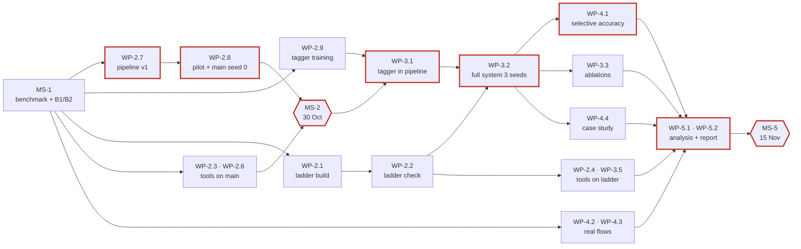
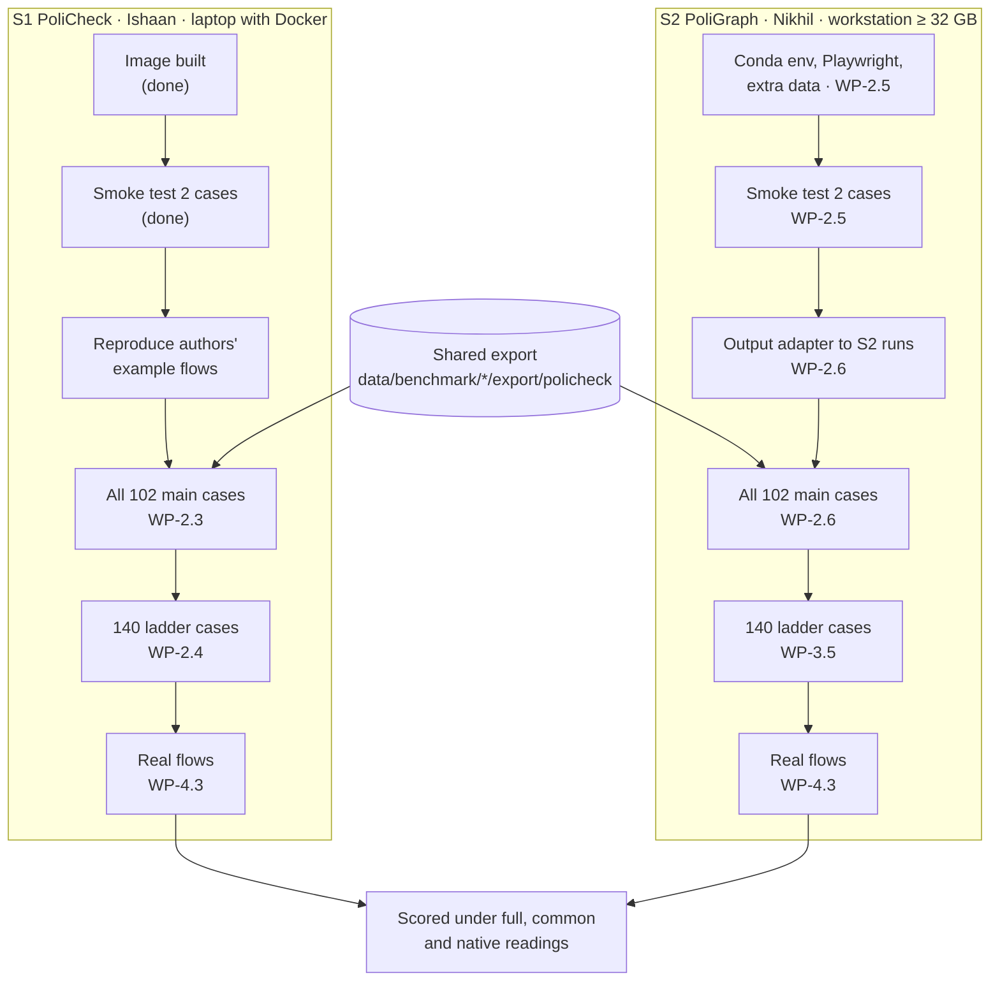

# DPDP-Audit — Project Plan

| | |
|---|---|
| **Version** | 2.0 (2026-10-25) |
| **Status** | Stage 2 complete (ladder check and spot-check done by two members and settled together, 28 Oct) · see [mid-submission report](docs/mid-submission-report.md) |
| **Key dates** | Mid-submission **Fri 30 Oct 2026** · final submission **Sun 15 Nov 2026** |
| **Team** | Anurag Kaushal (M1) · Ishaan Giri (M2) · Naveen Mishra (M3) · Nikhil Patidar (M4) |
| **Related** | [specs.md](specs.md) (what each work package must deliver) · [docs/](docs/README.md) (architecture, guides) · [proposal](docs/Neural_Nexus_Final.pdf) |

## 1. Objectives

1. **Benchmark.** Deliver a controlled benchmark for policy-vs-app compliance checking under the DPDP
   Act:
   - scripted answer keys;
   - a vagueness ladder;
   - a real-world check.
2. **Pipeline.** Build the evidence-gated DPDP-Audit pipeline. It must exercise the five course
   capabilities: fine-tuning, RAG, reasoning, agents and tool calling.
3. **Comparison.** Compare it head to head with PoliCheck, PoliGraph and single-pass LLM review on
   the same cases, and answer RQ1–RQ4 ([docs/evaluation.md](docs/evaluation.md#research-questions-and-hypotheses)).
4. **Submissions.** Submit the major results by the mid-submission and the complete study by the final
   submission.

## 2. Scope

| In scope | Out of scope |
|---|---|
| Five gap types: undisclosed collection, undisclosed sharing, purpose mismatch, retention mismatch, children's data | Legal judgements; other DPDP duties (security, breach notice, data-principal rights, cross-border transfer) |
| End-to-end systems: PoliCheck (S1), PoliGraph (S2), B1, B2, B4, DPDP-Audit and ablations A1–A5 | Tuning any system on evaluation cases; changing the tools' algorithms |
| Component baselines: PrivBERT (S3), PolicyLint/PoliGraph extraction (S4), prompted 3B tagger (B3) | Paid APIs or paid compute |
| Apps described by permissions, SDKs and data flows; real-flow sample; 3–5 open-source apps | Analysing app binaries or capturing network traffic ourselves |

Detailed scope per work package: [specs.md](specs.md).

## 3. Milestones

| ID | Milestone | Date | Exit criteria | Status |
|---|---|---|---|---|
| MS-0 | Setup | 15 Oct | Roles agreed; repository; PoliCheck builds; Qwen answers on Kaggle | **Done** |
| MS-1 | Benchmark and simplest baselines | 24 Oct | 102 cases with keys; B1/B2 scored on every case (SPEC-01, SPEC-02) | **Done** |
| MS-2 | **Mid-submission** | **30 Oct** | Must-have package of §7 complete and submitted | Package ready; ladder check done |
| MS-3 | Experiments complete | 7 Nov | All main and ladder runs, ablations, tagger results, spot-check (SPEC-02…06) | **Done** (29 Oct) |
| MS-4 | Evaluation complete | 11 Nov | Selective accuracy, real flows, case study (SPEC-07, SPEC-08) | Planned |
| MS-5 | **Final submission** | **15 Nov** | Final report, slides, release, reproduction check (SPEC-09) | Planned |

## 4. Schedule

Red bars are on the critical path (§6).

## 5. Work breakdown

| WP | Work package | Owner | Support | Dates | Depends on | Deliverable | Spec |
|---|---|---|---|---|---|---|---|
| **Stage 2 · core build** | | | | **25–30 Oct** | | | |
| WP-2.1 | Vagueness ladder: 35 ladders × 4 rungs, templates, residual-mention flags | Anurag | — | 25–26 Oct | MS-1 | `data/benchmark/ladder/`, check sheet | SPEC-06 |
| WP-2.2 | Ladder human check (two independent checkers) | Anurag | Ishaan | 27–28 Oct | WP-2.1 | Filled check sheet; rejected rungs removed | SPEC-06 |
| WP-2.3 | PoliCheck on all 102 main cases; reproduce the authors' example | Ishaan | — | 25–27 Oct | MS-1 | `results/runs/main/S1/`, raw CSV | SPEC-03 |
| WP-2.4 | PoliCheck on the 140 ladder cases | Ishaan | — | 29 Oct | WP-2.2 | `results/runs/ladder/S1/` | SPEC-03 |
| WP-2.5 | PoliGraph environment and 2-case smoke test on the workstation | Nikhil | Ishaan | 25–26 Oct | MS-1 | Working environment, smoke-test output | SPEC-03 |
| WP-2.6 | PoliGraph on main cases; output adapter to runs (S2) | Nikhil | Ishaan | 27–28 Oct | WP-2.5 | `results/runs/main/S2/`, raw CSV | SPEC-03 |
| WP-2.7 | DPDP-Audit pipeline v1 (prompted tagger, finder, 4 reviewers, aggregator, verifier) with unit tests | Naveen | Nikhil | 25–27 Oct | MS-1 | `src/dpdp_audit/pipeline/` | SPEC-04 |
| WP-2.8 | 5-case pilot with timing; full system seed 0 on main (Kaggle) | Naveen | — | 28–29 Oct | WP-2.7 | `results/runs/main/full/seed0/`, pilot timing | SPEC-04 |
| WP-2.9 | Tagger data; B3 prompted 3B; QLoRA 3B training; S3 PrivBERT | Nikhil | — | 26–29 Oct | MS-1 | Tagger predictions and metrics | SPEC-05 |
| WP-2.10 | B4 (Gemini) seed 0 on main | Anurag | — | 27–29 Oct | MS-1 | `results/runs/main/B4/seed0/` | SPEC-02 |
| WP-2.11 | Mid-submission package: results tables, report, docs | Anurag | All | 29–30 Oct | WP-2.3, 2.8 | Mid-submission report | SPEC-09 |
| **Stage 3 · experiments** | | | | **31 Oct–7 Nov** | | | |
| WP-3.1 | Fine-tuned tagger served to the pipeline (full vs A4) | Nikhil | Naveen | 31 Oct–1 Nov | WP-2.9, MS-2 | Tagger endpoint or cached tags | SPEC-05 |
| WP-3.2 | Full system, 3 seeds, main + ladder | Naveen | — | 2–5 Nov | WP-3.1, WP-2.2 | `results/runs/{main,ladder}/full/` | SPEC-04 |
| WP-3.3 | Ablations A1–A5, seed 0, main | Naveen | Anurag | 3–6 Nov | WP-3.1 | `results/runs/main/A*/` | SPEC-04 |
| WP-3.4 | B4 seeds 1–2 on main; B2 on ladder (3 seeds) | Anurag | — | 31 Oct–3 Nov | WP-2.10, WP-2.2 | `results/runs/*/B4`, `B2` | SPEC-02 |
| WP-3.5 | PoliGraph on ladder | Nikhil | — | 31 Oct–1 Nov | WP-2.2, WP-2.6 | `results/runs/ladder/S2/` | SPEC-03 |
| WP-3.6 | Statement-extraction comparison: tagger vs PolicyLint and PoliGraph (S4) | Ishaan | Nikhil | 1–3 Nov | WP-2.9 | Extraction F1 table | SPEC-05 |
| WP-3.7 | Answer-key spot-check: 20 cases against the policy text | Anurag | Ishaan | 2–3 Nov | MS-1 | Error rate | SPEC-09 |
| WP-3.8 | Results tables with intervals; paired tests; ladder statistics | Nikhil | — | 5–7 Nov | WP-3.2…3.5 | `results/scores/*.json` | SPEC-09 |
| **Stage 4 · evaluation extensions** | | | | **4–11 Nov** | | | |
| WP-4.1 | Selective accuracy: confidence, curves, R@95, rung analysis | Nikhil | — | 6–9 Nov | WP-3.2 | Curves and table | SPEC-07 |
| WP-4.2 | Real-flow sample (~25 apps, 60–80 flows) with two independent labels and κ | Anurag | Ishaan | 4–8 Nov | MS-1 | Labelled sample | SPEC-08 |
| WP-4.3 | Real-flow runs: S1, S2, B1, B2, full | Ishaan | Naveen | 9–10 Nov | WP-4.2 | Real-flow results | SPEC-08 |
| WP-4.4 | Open-source case study (3–5 repositories) | Naveen | — | 7–10 Nov | WP-3.2 | Hand-checked findings | SPEC-08 |
| **Stage 5 · analysis and final** | | | | **11–15 Nov** | | | |
| WP-5.1 | Failure analysis, hypothesis verdicts H1–H6, falsifiable claim | Nikhil | All | 11–12 Nov | MS-4 | Analysis section | SPEC-09 |
| WP-5.2 | Final report and slides | Anurag | All | 12–14 Nov | WP-5.1 | Report, slides | SPEC-09 |
| WP-5.3 | Fresh-clone reproduction check and release | Ishaan | — | 14 Nov | WP-5.2 | Checklist passed, tagged release | SPEC-09 |

## 6. Dependencies and critical path

The **critical path** runs from the pipeline build, through the fine-tuned tagger and the three-seed
runs, to selective accuracy and the final analysis. A slip in WP-2.7, WP-3.1 or WP-3.2 moves the final
date. The ladder and tool workstreams have one to two days of float.

## 7. Mid-submission (30 Oct) scope

The professor expects the major work at the mid-submission. Scope uses MoSCoW priorities: Must,
Should, Could and Won't (by 30 Oct).

| Priority | Item | WP |
|---|---|---|
| **Must** | Benchmark and B1/B2 results (done) | MS-1 |
| **Must** | Vagueness ladder built and checked (140 cases) | WP-2.1, WP-2.2 |
| **Must** | PoliCheck results on the main benchmark | WP-2.3 |
| **Must** | DPDP-Audit pipeline v1 with a seed-0 run on the main benchmark | WP-2.7, WP-2.8 |
| **Must** | Comparison table on the main benchmark (S1, B1, B2, full) with intervals | WP-2.11 |
| **Must** | Architecture, plan and specifications (this repository) | — |
| **Should** | PoliGraph results on the main benchmark | WP-2.6 |
| **Should** | Tagger results: B3, QLoRA 3B, PrivBERT (category macro-F1) | WP-2.9 |
| **Should** | B4 seed 0; PoliCheck on the ladder | WP-2.10, WP-2.4 |
| **Could** | Full system on the ladder (seed 0) | WP-3.2 (early) |
| **Won't** (by 30 Oct) | Ablations, seeds 1–2, selective accuracy, real flows, case study | Stages 3–4 |

**Package contents:**
1. a short report covering the problem, benchmark, systems, results so far and remaining plan;
2. results tables generated from `results/scores/`;
3. links to the repository documentation.

## 8. Existing-tool workstream: PoliCheck and PoliGraph

| Step | PoliCheck (S1) | PoliGraph (S2) |
|---|---|---|
| Environment | `scripts/tools/setup_policheck.sh` (Docker image, spaCy model, authors' NLP model) — done | `scripts/tools/run_poligraph.sh` on Nikhil's workstation (conda env, Playwright, extra data) |
| Input | Shared export: plaintext policies + `flows.csv` (frozen mapping) | Same export |
| Validation | Smoke test (done); reproduce the authors' example flows | 2-case smoke test before full runs |
| Main / ladder / real flows | WP-2.3 / WP-2.4 / WP-4.3 | WP-2.6 / WP-3.5 / WP-4.3 |
| Output | `results/tools/policheck/{split}/`, runs `S1` | `results/tools/poligraph/{split}/`, runs `S2` (adapter to be written in WP-2.6) |
| Component use | PolicyLint statement extraction for S4 (WP-3.6) | Graph statement extraction for S4 (WP-3.6) |
| Stop rule | If a tool cannot run after one full day of effort, document the reason and report it as not runnable | Same |

## 9. Responsibilities (RACI)

R = responsible (does the work) · A = accountable (owns the outcome) · C = consulted · I = informed.

| Work | Anurag (M1) | Ishaan (M2) | Naveen (M3) | Nikhil (M4) |
|---|---|---|---|---|
| Benchmark and ladder (SPEC-01, SPEC-06) | **A/R** | C (checker) | I | I |
| PoliCheck (SPEC-03) | I | **A/R** | I | C |
| PoliGraph (SPEC-03) | I | **A** | I | R |
| Single-pass baselines B1/B2 (SPEC-02) | C | I | **A/R** | I |
| B4 Gemini (SPEC-02) | R | I | **A** | I |
| DPDP-Audit pipeline and ablations (SPEC-04) | C | C | **A/R** | C |
| Tagger, PrivBERT, extraction comparison (SPEC-05) | I | R (S4) | C | **A/R** |
| Selective accuracy (SPEC-07) | I | I | C | **A/R** |
| Real flows and case study (SPEC-08) | **A/R** (real flows) | R (labels, tool runs) | R (case study) | I |
| Scoring and statistics (SPEC-09) | C | I | C | **A/R** |
| Reports, mid and final submission (SPEC-09) | **A/R** | R | R | R |

## 10. Compute and resources

| Resource | Holder | Used for | Limit |
|---|---|---|---|
| Kaggle account (2× T4) | Naveen | Pipeline runs and ablations (WP-2.8, 3.2, 3.3) | ~30 GPU-h/week, 12 h per session |
| Kaggle account | Nikhil | QLoRA tagger, B3, PrivBERT (WP-2.9) | ~30 GPU-h/week |
| Kaggle account | Anurag | B2 on the ladder; spare capacity; current dataset owner | ~30 GPU-h/week |
| Kaggle account | Ishaan | Real-flow LLM runs; spare capacity | ~30 GPU-h/week |
| Gemini API key (free tier) | Anurag | B4 | Daily request limits; spread over several days |
| Laptop with Docker | Ishaan | PoliCheck, PolicyLint | CPU |
| Workstation ≥ 32 GB RAM | Nikhil | PoliGraph | CPU, optional GPU |

The private Kaggle dataset `anuragkaushal183/dpdp-audit` is shared with the members who run kernels.
Alternatively, each member can upload their own copy with `scripts/kaggle_push.sh`, after changing
the owner in `kaggle/b1b2/kernel-metadata.json`. Estimated GPU time per workload:
[docs/infrastructure.md](docs/infrastructure.md#compute-budget).

## 11. Quality gates and definition of done

**Definition of done (every work package):**
- the code is merged and `pytest` passes;
- results are committed under `results/` and scores regenerated with `scripts/score_runs.py`;
- the spec's acceptance criteria are ticked with evidence;
- the documentation is updated;
- the command that reproduces the result is recorded.

| Gate | When | Checks |
|---|---|---|
| G-2 Mid-submission readiness | 29 Oct, end of day | All Must items of §7 done; tests pass; tables generated from committed runs; report reviewed by two members |
| G-3 Experiment freeze | 7 Nov | All planned runs present; no `call failed` runs left; mappings and rules unchanged since MS-2; scores regenerated |
| G-5 Final readiness | 14 Nov | A fresh clone reproduces benchmark, scores and tables; every acceptance criterion is ticked or explicitly deferred; final report reviewed by all |

## 12. Risk register

| ID | Risk | L | I | Mitigation | Contingency | Owner |
|---|---|---|---|---|---|---|
| R-01 | Five days to the mid-submission is tight | H | H | MoSCoW scope (§7); Must items first; daily check-in | Present the pipeline on the pilot + seed-0 run; move Should items to Stage 3 | Anurag |
| R-02 | Kaggle GPU quota or 12 h session limit | M | H | Four accounts; seed-first ordering; resume; 10 h deadline guard; cached LLM calls | Cut ablation cases first; one seed on the ladder | Naveen |
| R-03 | Pipeline slower than estimated | M | H | 5-case pilot measures time per run before full runs | Reduce reviewer tool calls; one seed for the ladder | Naveen |
| R-04 | PoliGraph environment fails on the workstation | M | M | Smoke test by 26 Oct; Ishaan supports; authors' instructions pinned in the script | Stop rule: report as not runnable with the documented reason | Ishaan |
| R-05 | PoliCheck run time on 242 cases | M | M | Batch by policy; run overnight; main before ladder | Ladder on a subset of ladders | Ishaan |
| R-06 | Gemini free-tier limits delay B4 | M | L | Spread runs over days; cache | B4 on seed 0 only, stated as a limitation | Anurag |
| R-07 | Fine-tuned tagger underperforms | M | M | B3 and PrivBERT comparisons; the oracle tagger (A5) separates reading errors | Keep the prompted tagger in the full system (A4 configuration) and report it | Nikhil |
| R-08 | Ladder base policy still mentions the target | M | M | Automated residual-mention flags; two independent checkers | Drop failed ladders; report how many | Anurag |
| R-09 | Answer-key errors from annotation noise | L | M | 20-case spot-check; error rate reported | Correct the keys and re-score before the experiment freeze | Anurag |
| R-10 | Real-flow policies unavailable (dead URLs) | M | L | Archived copies; sample only apps with retrievable policies | The open-source case study becomes the real-data result | Anurag |
| R-11 | Tool mapping loss (65% of flows exportable, 12% exact) | H | M | Frozen mapping; coverage reported; native reading | State as a limitation of tool comparisons | Ishaan |
| R-12 | Integration conflicts between parallel work | M | M | One branch per WP; frozen artefacts; `git pull --rebase` daily | Integration owner (Anurag) merges in dependency order | Anurag |

L = likelihood, I = impact (H/M/L).

## 13. Working agreements

- **Check-in:** 15 minutes daily (in person or chat). Each member reports yesterday, today and
  blockers; WP status in §5 is updated after the check-in.
- **Git:** one branch per work package (e.g. `wp-2.7-pipeline`), merged to `main` when tests pass.
  Commits are made under each member's own identity with real dates.
- **Changes:** a change of scope or acceptance criteria updates `specs.md` first, then this plan.
  Frozen artefacts change only by team agreement, recorded in `specs.md`.

## 14. Change log

| Version | Date | Change |
|---|---|---|
| 1.0 | 2026-10-23 | Five-week stage plan derived from the proposal |
| 2.6 | 2026-10-29 | Stage 3 complete: S4 scored (WP-3.6; tuple F1 PolicyLint 0.106, PoliGraph 0.234, QLoRA 0.479); v2 ablations on 3 seeds and A2/A3 on the ladder (WP-3.3); 95% intervals for every system (WP-3.8). Without DPDP retrieval v2 is as good or better on every seed |
| 2.5 | 2026-10-29 | Stage 3 started: pipeline seeds 1–2 on the ladder (AC-04.11, 1,120 runs); per-flow confidence export for SPEC-07 (AC-04.13); S4 extraction jobs and term mapping (WP-3.6) |
| 2.4 | 2026-10-29 | Ladder and spot-check disagreements settled together by Naveen and Anurag: 110 of 140 rungs accepted (was 100 before settling); answer key wrong on 9 of 87 checked flows (10.3%). Report §5 updated; H4 now fails for every system |
| 2.3 | 2026-10-28 | Verifier reply bug found (15–40% of pipeline runs unreadable, findings kept unchecked); robust reader and `scripts/reverify.py`; every verifier-using run re-verified as `*_rv`, which the report now uses. v1 with a working verifier does not beat B2 on F1; v2 reaches F1 0.705 |
| 2.2 | 2026-10-27 | Pipeline v2 (`full_v2`, `full_v2_finetuned`) developed on the dev splits (new `dev2`, 69 cases from 23 more training policies), frozen, then run on main (3 seeds) and the ladder; ablations repeated on v2 (`A*_v2`); B4 seeds 1–2 done; PoliCheck known-answer check done (7/7). The frozen v1 runs are kept |
| 2.1 | 2026-10-26 | Stage 2 run by one member (Ishaan) on account `ishaan2312`: pipeline, ladder, tools on the ladder, B4 seed 0, ablations A1/A2/A3/A5 early; dev split for prompt development |
| 2.0 | 2026-10-25 | Dated schedule (mid-submission 30 Oct, final 15 Nov); work packages, RACI, critical path, MoSCoW, risk register; comparison set S1 PoliCheck and S2 PoliGraph; PoliGraph on Nikhil's workstation |
