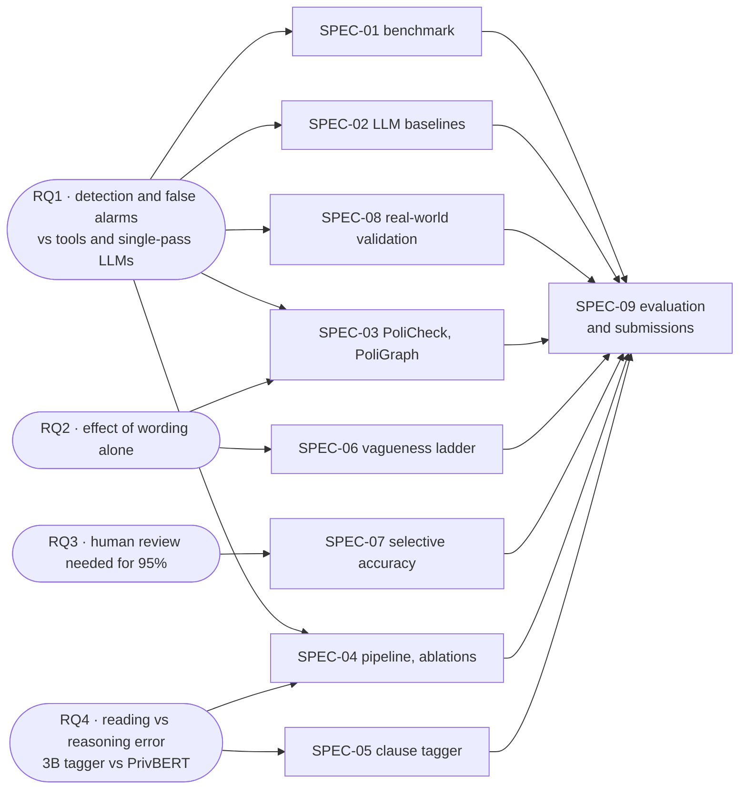

# DPDP-Audit — Specifications

| | |
|---|---|
| **Version** | 2.0 (2026-10-25) |
| **Scope** | All work packages of the project, Stage 0 to Stage 5 |
| **Schedule** | [plan.md](plan.md) (milestones MS-0 … MS-5, work packages WP-n.n) |
| **Background** | [docs/README.md](docs/README.md) · [proposal](docs/Neural_Nexus_Final.pdf) |

## How to read this document

- **Template:** each specification follows the same template: Context, Goal, Scope, Non-Goals,
  Acceptance Criteria, Evidence & Validation, Open Questions.
- **Header table:** gives the owner, status, milestone, dependencies, and the research questions and
  hypotheses it serves.
- **Requirement keywords:** **MUST** = required for acceptance, **SHOULD** = expected unless a reason
  is recorded, **MAY** = optional.
- **Acceptance criteria:** numbered `AC-NN.k` and ticked only with evidence. Unticked criteria name the
  work package that delivers them.
- **Status:** **Done** · **In progress** · **Planned**.

## Specification index

| ID | Title | Owner | Status | Milestone | Depends on |
|---|---|---|---|---|---|
| [SPEC-01](#spec-01--main-benchmark) | Main benchmark | Anurag | Done (spot-check pending) | MS-1 | — |
| [SPEC-02](#spec-02--single-pass-llm-baselines-b1-b2-b4) | Single-pass LLM baselines B1, B2, B4 | Naveen | In progress | MS-1 → MS-3 | SPEC-01 |
| [SPEC-03](#spec-03--existing-tool-baselines-policheck-s1-and-poligraph-s2) | Existing-tool baselines: PoliCheck and PoliGraph | Ishaan | Main and ladder done; real flows pending | MS-2 → MS-4 | SPEC-01, SPEC-06 |
| [SPEC-04](#spec-04--dpdp-audit-pipeline-and-ablations) | DPDP-Audit pipeline and ablations | Naveen | In progress (v1 frozen and v2 chosen on dev splits, both main × 3 seeds + ladder; ablations on v1 and v2) | MS-2 → MS-3 | SPEC-01, SPEC-02, SPEC-05 |
| [SPEC-05](#spec-05--clause-tagger-fine-tuning-and-component-baselines) | Clause tagger: fine-tuning and component baselines | Nikhil | In progress (QLoRA 0.713 macro-F1, in the pipeline; S4 extraction pending) | MS-2 → MS-3 | SPEC-01 |
| [SPEC-06](#spec-06--vagueness-ladder) | Vagueness ladder | Anurag | Built and scored; human check pending | MS-2 | SPEC-01 |
| [SPEC-07](#spec-07--selective-accuracy) | Selective accuracy | Nikhil | Planned | MS-4 | SPEC-02, SPEC-03, SPEC-04, SPEC-06 |
| [SPEC-08](#spec-08--real-world-validation) | Real-world validation: real flows and case study | Anurag | Planned | MS-4 | SPEC-02, SPEC-03, SPEC-04 |
| [SPEC-09](#spec-09--evaluation-reporting-and-submissions) | Evaluation, reporting and submissions | Anurag | In progress | MS-2, MS-5 | all |

## Traceability

| Hypothesis | Specs | Evidence |
|---|---|---|
| H1 · full system beats PoliCheck and PoliGraph on collection/sharing | SPEC-03, SPEC-04 | common views, label macro-F1 |
| H2 · full system beats B1 and B2 on the full benchmark, most on vague and omission | SPEC-02, SPEC-04 | full view per level |
| H3 · verifier lowers false alarms with at most 5 points recall loss | SPEC-04 | full vs A1 |
| H4 · every system is less accurate on vague than on explicit rungs | SPEC-06 | paired rung accuracy |
| H5 · full system needs less review than B2 for 95%; lower confidence on vague rungs | SPEC-07 | R@95, rung confidence |
| H6 · fine-tuned tagger beats B3, within 5 points of PrivBERT, closes half the A4–A5 gap | SPEC-05, SPEC-04 | macro-F1, A4/A5 |

## Constraints for every specification

1. **No LLM in ground truth.** Answer keys and ladder rungs come from scripts and templates, checked by
   people.
2. **Frozen artefacts.** Changes need team agreement recorded here:
   - `data/benchmark/main/`
   - `data/dpdp/gap_to_section.csv`
   - `data/tools/*mapping*.csv`
   - `src/dpdp_audit/gold_rules.py`
3. **No tuning on evaluation cases.** Prompts and thresholds are fixed before test runs.
4. **Free compute only:** laptops, Docker, Kaggle, Gemini free tier and the team workstation.
5. **Reproducibility.** Every versioned result lives under `results/` and is regenerated by a recorded
   command; seeds are fixed.
6. **Same information.** B2 receives exactly the inputs the pipeline receives.
7. **Compliance gaps, not legal violations.** No output is legal advice.

---

## SPEC-01 · Main benchmark

| | |
|---|---|
| **Owner** | Anurag Kaushal (M1) |
| **Status** | Done (AC-01.10 pending, WP-3.7) |
| **Milestone** | MS-1 (24 Oct) |
| **Depends on** | — |
| **Traces** | RQ1 · H1, H2 |

### 1. Context
- **Problem:** No benchmark exists whose correct answers for policy-vs-app compliance gaps under the
  DPDP Act are known without human or LLM judgement.
- **Current Behavior:** Implemented. 102 cases with scripted answer keys are committed.
- **Affected Systems:**
  - `src/dpdp_audit/` modules: `opp115`, `split`, `gold_rules`, `cells`, `generator`, `cases`,
    `export_policheck`;
  - `data/splits.json` and `data/benchmark/`.

### 2. Goal
- Cases with scripted answer keys from the 35 held-out OPP-115 policies: one compliant control and two
  variants per policy.

### 3. Scope
- **Allowed Write Paths:**
  - the modules above;
  - `scripts/download_opp115.sh`, `scripts/count_cells.py`, `scripts/generate_cases.py`,
    `scripts/export_policheck.py`;
  - `data/splits.json`, `data/benchmark/`, `tests/`.
- **Read-Only Context:** `data/raw/OPP-115/` (consolidated annotations, threshold 0.75).

### 4. Non-Goals
- The vagueness ladder (SPEC-06) and real data (SPEC-08).
- Legal interpretation beyond the fixed gap-to-section table.

### 5. Acceptance Criteria
- [x] **AC-01.1** OPP-115 MUST be split by policy into 80 training and 35 held-out policies (seed 13).
- [x] **AC-01.2** Usable cases MUST be counted per gap type × level. Cells under 10 policies are marked
  exploratory.
- [x] **AC-01.3** The benchmark MUST contain 102 cases (34 controls, 68 variants), 118 gold findings
  and 433 labelled flows.
- [x] **AC-01.4** Answer keys MUST be computed by the fixed rules for every flow. Case folders MUST NOT
  contain the answer.
- [x] **AC-01.5** Every control MUST have zero findings and every variant at least one.
- [x] **AC-01.6** Edge case: a policy without a clearly covered flow MUST be skipped, not given a
  wrong control.
- [x] **AC-01.7** Edge case: generic negative statements MUST NOT count as explicit contradictions.
- [x] **AC-01.8** Every case MUST be exported in PoliCheck's input format, with mapping coverage
  reported (65% of flows exportable, 12% exact).
- [x] **AC-01.9** Regeneration with the same seeds MUST reproduce the committed files byte for byte.
- [ ] **AC-01.10** A 20-case spot-check against the policy text MUST report the answer-key error rate
  (WP-3.7).

### 6. Evidence & Validation
- `tests/test_benchmark.py`, `test_gold_rules.py`, `test_opp115.py`, `test_export.py` pass.
- `data/benchmark/main/summary.json`, `data/benchmark/cell_counts.csv`,
  `data/benchmark/main/export/policheck/coverage.json`.
- `git status data/` is clean after the regeneration commands in `docs/reproduction.md`.

### 7. Open Questions
- None.

---

## SPEC-02 · Single-pass LLM baselines (B1, B2, B4)

| | |
|---|---|
| **Owner** | Naveen Mishra (M3); B4 runs: Anurag Kaushal |
| **Status** | In progress (B1, B2, B4 on main × 3 seeds and B2 on the ladder × 3 done; real flows pending) |
| **Milestone** | MS-1, MS-2 (B4 seed 0), MS-3 (B4 seeds 1–2, B2 ladder) |
| **Depends on** | SPEC-01; SPEC-06 for ladder runs |
| **Traces** | RQ1 · H2 |

### 1. Context
- **Problem:** We need to know whether a staged pipeline beats simply prompting the same model once,
  and whether a stronger model beats both.
- **Current Behavior:**
  - B1 and B2 ran on all 102 cases with three seeds on Qwen2.5-7B-Instruct-AWQ (612 runs);
  - B4 (gemini-3-flash-preview) ran on all 102 cases with three seeds (306 runs, 0 failed).
- **Affected Systems:**
  - `src/dpdp_audit/baselines.py`, `llm.py`, `runs.py`;
  - `scripts/run_baselines.py`, `kaggle/b1b2/`, `notebooks/`;
  - the Gemini API.

### 2. Goal
- B1, B2 and B4 runs on the main benchmark (three seeds), B2 on the ladder (three seeds), and B1/B2 on
  real flows, all scored.

### 3. Scope
- **Allowed Write Paths:**
  - the modules and scripts above;
  - `results/runs/{split}/B1|B2|B4/`, `results/scores/`, `results/stage0_model_check.json`.
- **Read-Only Context:**
  - `data/benchmark/`;
  - `data/dpdp/` (units and gap-to-section table);
  - `data/tools/sdk_table.csv`.

### 4. Non-Goals
- Prompt engineering on evaluation cases.
- Models other than Qwen2.5-7B-Instruct (B1, B2) and `gemini-3-flash-preview` (B4).

### 5. Acceptance Criteria
- [x] **AC-02.1** B1 and B2 MUST run on all 102 main cases with seeds 0–2, with 0 failed and
  0 unparseable runs.
- [x] **AC-02.2** B2 MUST receive exactly the parsed app facts and retrieved DPDP units the pipeline
  receives.
- [x] **AC-02.3** A failed call (timeout, context overflow) MUST be saved as a failed run, and
  `--redo-failed` MUST re-run it.
- [x] **AC-02.4** Kaggle jobs MUST run seed-first, resume from saved runs, stop starting work at
  10 hours and always pack their results.
- [x] **AC-02.5** The Stage 0 model check MUST show the model answering with token log-probabilities.
- [x] **AC-02.6** B4 MUST run on the main benchmark with seed 0 (WP-2.10, MS-2). *Evidence: `results/runs/main/B4/seed0/` (102 runs, 0 failed).*
- [x] **AC-02.7** B4 seeds 1–2 SHOULD run on the main benchmark (WP-3.4, MS-3). *Evidence: `results/runs/main/B4/seed1/`, `seed2/` (204 runs, 0 failed, 27 Oct).*
- [x] **AC-02.8** B2 MUST run on the 140 ladder cases with seeds 0–2 (WP-3.4, MS-3). *Evidence: `results/runs/ladder/B2/`.*
- [ ] **AC-02.9** B1 and B2 MUST run on the real-flow sample (WP-4.3, SPEC-08).

### 6. Evidence & Validation
- `results/runs/main/B1/`, `results/runs/main/B2/` (306 runs each).
- `results/scores/main.json`, `results/stage0_model_check.json`.
- `tests/test_baselines.py`, `tests/test_llm.py` pass.

### 7. Open Questions
- **Rate limits:** Gemini free-tier daily limits may stretch B4 over several days. If they block seeds
  1–2, B4 is reported on seed 0 only.
- **Model drift:** `gemini-3-flash-preview` is a preview model and may change. The exact model name is
  stored with every run.

---

## SPEC-03 · Existing-tool baselines: PoliCheck (S1) and PoliGraph (S2)

| | |
|---|---|
| **Owner** | Ishaan Giri (M2); PoliGraph runs: Nikhil Patidar (workstation) |
| **Status** | Main and ladder done (PoliCheck and PoliGraph); real flows pending |
| **Milestone** | MS-2 (main), MS-3 (ladder), MS-4 (real flows) |
| **Depends on** | SPEC-01; SPEC-06 for ladder runs |
| **Traces** | RQ1, RQ2 · H1, H4 |

### 1. Context
- **Problem:** The course staff asked for comparison with the state of the art. PoliCheck is the
  closest prior work: it labels each (data type, recipient) flow against the policy. PoliGraph is a
  newer knowledge-graph approach that runs the same check.
- **Current Behavior:**
  - PoliCheck and PoliGraph ran on all 102 main and 140 ladder cases (Kaggle) and were converted to our
    format; PoliCheck passed the known-answer check (7 of 7).
- **Affected Systems:**
  - `scripts/tools/`, `src/dpdp_audit/tool_runs.py`;
  - the PoliCheck Docker image;
  - the PoliGraph conda environment on Nikhil's workstation (≥ 32 GB RAM).

### 2. Goal
- S1 and S2 labels for every collection/sharing flow of the main (102) and ladder (140) cases and the
  real-flow sample, converted to runs and scored under the full, common and native readings.

### 3. Scope
- **Allowed Write Paths:**
  - `scripts/tools/`, `src/dpdp_audit/tool_runs.py` (a PoliGraph converter is added here),
    `tests/test_tool_runs.py`;
  - `results/tools/{policheck,poligraph}/{split}/`, `results/runs/{split}/S1|S2/`.
- **Read-Only Context:**
  - the authors' repositories under `data/external/`. The only patches allowed are the documented
    build fixes: removing `apt-get`, and installing the spaCy model from a local file.
  - `data/benchmark/*/export/policheck/` and `data/tools/` mappings (frozen).

### 4. Non-Goals
- Changing either tool's algorithm, ontology or patterns.
- Purpose, retention and children's-data gaps, which the tools do not model. Coverage is reported
  instead.

### 5. Acceptance Criteria
- [x] **AC-03.1** The PoliCheck image MUST build from `scripts/tools/setup_policheck.sh`.
- [x] **AC-03.2** A PoliCheck smoke test on 2 cases MUST run and convert to our run format.
- [x] **AC-03.3** The converter MUST map PoliCheck's ontology terms and entities back to our flows,
  with a unit test.
- [x] **AC-03.4** PoliCheck SHOULD reproduce its result on the authors' example flows, to validate the
  set-up (WP-2.3). *Changed 26 Oct: the authors ship flows but neither policies nor labels, so nothing
  can be reproduced; a known-answer check replaces it (`data/tools/policheck_sanity/`,
  `scripts/check_policheck_sanity.py`). Evidence: `results/tools/policheck/sanity/check.json`, 7 of 7
  agree, covering all five labels (27 Oct). A first six-case version
  (`results/tools/policheck/sanity_6case/`) agreed on 5 of 6: PoliCheck reads "We share your location
  with Google" as vague for a flow to Google Ads, because its entity ontology puts "google ads" under
  "Google"; the clear case now uses Facebook, which PoliCheck matches exactly.*
- [x] **AC-03.5** PoliCheck MUST label all 102 main cases (WP-2.3, MS-2). *Evidence: `results/runs/main/S1/` (282/282 exported flows matched), Kaggle run 26 Oct.*
- [x] **AC-03.6** PoliCheck MUST label all 140 ladder cases (WP-2.4). *Evidence: `results/tools/policheck/ladder/`, `results/runs/ladder/S1/` (140/140 matched).*
- [x] **AC-03.7** The PoliGraph environment MUST pass a 2-case smoke test on the workstation by 26 Oct
  (WP-2.5). *Met on Kaggle instead of the workstation (`kaggle/poligraph/`), with full runs on main and ladder.*
- [x] **AC-03.8** A PoliGraph converter MUST turn its output into S2 runs, with a unit test (WP-2.6). *Evidence: `tool_runs.poligraph_outputs`, `scripts/convert_tool_runs.py`, `tests/test_tool_runs.py`.*
- [x] **AC-03.9** PoliGraph MUST label the main cases (WP-2.6) and the ladder cases (WP-3.5). *Evidence: `results/runs/{main,ladder}/S2/`; 31/34 and 31/35 policies parsed (PoliGraph rejects 1582, 642, 760 and, on the ladder, 988 as "not like a privacy policy").*
- [x] **AC-03.10** S1 and S2 MUST be scored under the full, common and native readings, with coverage
  reported. *Evidence: `results/scores/main.json`, `results/scores/ladder.json`, `docs/baseline-report.md`.*
- [ ] **AC-03.11** S1 and S2 MUST run on the real-flow sample (WP-4.3).
- [ ] **AC-03.12** Failure state: a tool that cannot run after one full day of effort MUST be
  documented with its reason and reported as not runnable.

### 6. Evidence & Validation
- `results/tools/policheck/{split}/policheck_results.csv`,
  `results/tools/poligraph/{split}/poligraph_results.csv`.
- `results/runs/{split}/S1/`, `results/runs/{split}/S2/`; scores in `results/scores/{split}.json`.
- `tests/test_tool_runs.py` passes, including the PoliGraph converter.

### 7. Open Questions
- **Run time:** PoliCheck's run time on 242 cases is unknown, so the runs are batched by policy and
  run overnight.
- **First-party detection:** PoliGraph's first-party detection relies on the package name and the
  domain (`com.dpdpaudit.<case>` vs `api.<case>.dpdpaudit.com`). This must be verified in the smoke
  test.

---

## SPEC-04 · DPDP-Audit pipeline and ablations

| | |
|---|---|
| **Owner** | Naveen Mishra (M3) |
| **Status** | In progress (v1 and v2 on main × 3 and the ladder × 1; ablations on both) |
| **Milestone** | MS-2 (v1, seed 0 on main), MS-3 (three seeds, ladder, ablations) |
| **Depends on** | SPEC-01, SPEC-02 (LLM client, runner), SPEC-05 (fine-tuned tagger) |
| **Traces** | RQ1, RQ4 · H1, H2, H3, H6 |

### 1. Context
- **Problem:** Single-pass review over-flags compliant apps (false-alarm rate 0.75–0.97) and finds
  about a fifth of the gaps. The proposal's evidence-gated pipeline does not exist yet.
- **Current Behavior:**
  - The shared services are implemented: app tools, DPDP retrieval and the cached LLM client.
  - No tagger, mismatch finder, reviewers, aggregator or verifier exist yet.
- **Affected Systems:**
  - new package `src/dpdp_audit/pipeline/` and `scripts/run_pipeline.py`;
  - the Kaggle job;
  - `results/runs/{split}/full|A1…A5/`.

### 2. Goal
- The six-stage pipeline specified in `docs/pipeline.md`, run as `full` and ablations A1–A5, producing
  findings and a disclosure label for every flow.

### 3. Scope
- **Allowed Write Paths:**
  - `src/dpdp_audit/pipeline/`, `scripts/run_pipeline.py`, `kaggle/`, `tests/`;
  - `results/runs/`, `results/pipeline_pilot.json`.
- **Read-Only Context:**
  - `src/dpdp_audit/tools/`, `retrieval.py`, `llm.py`, `baselines.py` (reuse without changing their
    behaviour);
  - `data/benchmark/`, `data/dpdp/`.

### 4. Non-Goals
- Training the tagger (SPEC-05).
- Selective-accuracy analysis (SPEC-07).
- Any change to the answer keys or the scorer's metric definitions.

### 5. Acceptance Criteria
- [x] **AC-04.1** The six stages MUST follow the data contracts in `docs/pipeline.md`: tagger, tools,
  mismatch finder, four specialist reviewers, aggregator and evidence verifier.
- [x] **AC-04.2** Reviewers MUST be able to call `search_policy`, `retrieve_dpdp` and `lookup_sdk`,
  at most 3 calls each. An unknown tool MUST return an error message, and tool-call validity MUST be
  logged.
- [x] **AC-04.3** The verifier MUST drop a finding whose quote is not verbatim in the inputs (an empty
  quote is allowed only for an omission) or whose sections do not exist. It MUST mark a finding
  uncertain when the LLM check finds no support.
- [x] **AC-04.4** Every flow MUST receive a disclosure label (clear, vague, omitted or incorrect).
- [x] **AC-04.5** A1–A5 MUST be configuration switches of one implementation.
- [x] **AC-04.6** Edge cases MUST be handled: no candidates, a non-JSON reply, an unknown tool, a quote
  not found, an invalid section name, and a prompt longer than the context window.
- [x] **AC-04.7** Failure handling MUST match the baselines: failed calls saved, `--redo-failed`, a
  deadline guard and seed-first ordering.
- [x] **AC-04.8** Unit tests with a scripted fake LLM MUST cover the tool loop, the aggregator and the
  verifier, without API access.
- [x] **AC-04.9** A 5-case pilot MUST record seconds and LLM calls per run, and extrapolate to the full
  run budget (WP-2.8).
- [x] **AC-04.10** `full` MUST run on the main benchmark with seed 0 by MS-2 (WP-2.8).
- [ ] **AC-04.11** `full` MUST run with seeds 0–2 on the main and ladder benchmarks (WP-3.2). *Main done for v1 and v2 (3 seeds each); the ladder has seed 0 only.*
- [x] **AC-04.12** A1–A5 MUST run with seed 0 on the main benchmark (WP-3.3). A5 (oracle tagger) is not
  applied to the ladder. *Evidence: `results/runs/main/A1`, `A2`, `A3`, `A5` (v1) and `A1_v2`, `A2_v2`, `A3_v2`, `A5_v2` (v2), each re-verified as `*_rv`; A4 (prompted tagger) is `full` / `full_v2`.*
- [ ] **AC-04.13** A per-flow confidence (seed agreement, token-probability tie-break) MUST be
  exported for SPEC-07.

### 6. Evidence & Validation
- `tests/test_pipeline.py` passes, together with the existing suite.
- `results/pipeline_pilot.json` (timing per run, LLM calls per run).
- `results/runs/{main,ladder}/full/`, `results/runs/main/A1…A5/`; scores in `results/scores/`.

### 7. Open Questions
- **Tagger at MS-2:** until SPEC-05 delivers, the full system uses the prompted tagger. The fine-tuned
  tagger replaces it in WP-3.1, and both are reported.
- **Long policies:** the context limit is 12,288 tokens, so reviewers see only the paragraphs linked to
  their candidates.
- **v2 (27 Oct):** the frozen pipeline's problems were fixed as new configurations (`full_v2`, `full_v2_finetuned`, switches in `pipeline/config.py`), chosen on the dev splits `dev` + `dev2` (training policies) and frozen before their single run on main and the ladder (constraint 3). The frozen v1 runs stay in every table. Details: `docs/pipeline.md#v2`.
- **Verifier reply bug (28 Oct):** the frozen reader could not read 15–40% of the verifier's replies and kept those findings unchecked. Fixed by a robust reader; every verifier-using run was re-verified (`scripts/reverify.py`, configurations `*_rv`), and the reported numbers use these. The frozen runs are unchanged.

---

## SPEC-05 · Clause tagger: fine-tuning and component baselines

| | |
|---|---|
| **Owner** | Nikhil Patidar (M4); S4 extraction: Ishaan Giri |
| **Status** | In progress (QLoRA tagger trained, 0.713 macro-F1, used in the pipeline; S4 pending) |
| **Milestone** | MS-2 (should: tagger metrics), MS-3 (in the pipeline, S4) |
| **Depends on** | SPEC-01 (split) |
| **Traces** | RQ4 · H6 |

### 1. Context
- **Problem:** The pipeline needs cheap, on-premise reading of long policies. We test whether a
  fine-tuned 3B model reads policies as well as a strong published classifier and better than
  prompting.
- **Current Behavior:** Not implemented. The 80/35 split exists.
- **Affected Systems:**
  - new `src/dpdp_audit/tagger_data.py`, `tagger_eval.py`;
  - Kaggle training jobs;
  - the PoliCheck/PolicyLint image and PoliGraph (extraction).

### 2. Goal
- Tagger predictions and metrics for B3 (prompted Qwen2.5-3B), our QLoRA Qwen2.5-3B, S3 (PrivBERT) and
  S4 (PolicyLint and PoliGraph extraction) on the 35 held-out policies, and the fine-tuned tagger
  served to the pipeline.

### 3. Scope
- **Allowed Write Paths:**
  - `src/dpdp_audit/tagger_*.py`, `scripts/`, `kaggle/`, `tests/`;
  - `data/tagger/`, `results/tagger/`, `results/scores/tagger.json`.
- **Read-Only Context:** `data/raw/OPP-115/`, `data/splits.json`.

### 4. Non-Goals
- Tagging categories the pipeline does not use, beyond the 10-category macro-F1 report.
- Training on held-out policies.

### 5. Acceptance Criteria
- [x] **AC-05.1** Training data MUST come from the 80 training policies only, with a test asserting
  that they are disjoint from the 35 held-out policies.
- [x] **AC-05.2** B3 MUST be evaluated zero-shot on all held-out paragraphs.
- [x] **AC-05.3** QLoRA MUST train Qwen2.5-3B (4-bit, rank 16, 2 epochs) on a Kaggle T4, and the
  adapter MUST be saved.
- [x] **AC-05.4** S3 PrivBERT (`mukund/privbert`) MUST be fine-tuned on the same split.
- [x] **AC-05.5** Metrics MUST be computed:
  - category macro-F1 over the 10 OPP-115 categories;
  - tuple F1 for (category, data type, does/does not);
  - tuple F1 for (category, data type, third party).
- [ ] **AC-05.6** S4 PolicyLint and PoliGraph statements MUST be mapped to the same tuples and scored
  (WP-3.6).
- [x] **AC-05.7** The fine-tuned tagger MUST be usable by the pipeline (a vLLM LoRA adapter or cached
  tags), enabling `full` vs A4 (WP-3.1).

### 6. Evidence & Validation
- `results/tagger/*_predictions.jsonl` and `results/scores/tagger.json`.
- Tests for the data builder (split disjointness) and the metrics.

### 7. Open Questions
- **Serving:** serve the adapter next to Qwen-7B on vLLM, or tag every policy once offline and cache
  the claims? The offline option is simpler; it is decided in WP-3.1.

---

## SPEC-06 · Vagueness ladder

| | |
|---|---|
| **Owner** | Anurag Kaushal (M1); second checker: Ishaan Giri |
| **Status** | Built and scored; human check in progress (first checker done) |
| **Milestone** | MS-2 |
| **Depends on** | SPEC-01 |
| **Traces** | RQ2, RQ3 · H4, H5 |

### 1. Context
- **Problem:** In the main benchmark, vague and explicit cases come from different policies, so
  wording is confounded with everything else about a policy. Explicit and omitted collection/sharing
  cells are also rare in OPP-115.
- **Current Behavior:** Not implemented.
- **Affected Systems:** new `src/dpdp_audit/ladder.py`, `scripts/build_ladder.py`,
  `data/benchmark/ladder/`.

### 2. Goal
- 35 ladders × 4 rungs = 140 cases, in which the same policy and app differ by exactly one sentence,
  checked by two people.

### 3. Scope
- **Allowed Write Paths:** `src/dpdp_audit/ladder.py`, `scripts/build_ladder.py`, `tests/`,
  `data/benchmark/ladder/`.
- **Read-Only Context:** `data/raw/OPP-115/`, `src/dpdp_audit/gold_rules.py`, `data/tools/` mappings.

### 4. Non-Goals
- LLM-written or LLM-judged rewrites.
- Ladders for purpose, retention or children's data.

### 5. Acceptance Criteria
- [x] **AC-06.1** Each held-out policy MUST give one ladder for one collection or sharing flow (about 2
  sharing ladders per collection ladder), using a data type PoliCheck can express.
- [x] **AC-06.2** The base policy MUST remove every sentence the annotations mark as covering the
  target practice for the target data type or for generic data.
- [x] **AC-06.3** The four rungs (clear, explicit, vague, deleted) MUST differ from the deleted rung
  only by one inserted sentence, at the same position (automated test). The app MUST be identical
  across rungs.
- [x] **AC-06.4** Rung sentences MUST come from fixed templates. Gold labels are clear, incorrect,
  vague and omitted.
- [x] **AC-06.5** Base-policy sentences that still mention the target data type next to a practice
  verb MUST be auto-flagged in the check sheet.
- [ ] **AC-06.6** (WP-2.2, pending: needs two people; `check_sheet.csv` is ready) Two members MUST check every rung independently. Only rungs both mark "ok" are used,
  and the number dropped is reported.
- [x] **AC-06.7** The ladder MUST be exported in PoliCheck format for S1 and S2.
- [x] **AC-06.8** Ladder scoring MUST report:
  - label accuracy per rung;
  - paired differences between rungs (McNemar's test);
  - the confusion between neighbouring labels.

### 6. Evidence & Validation
- Built 26 Oct (`scripts/build_ladder.py`): 35 ladders (23 sharing, 12 collection), 735 sentences
  removed, residual flags on 23 ladders; S1 and S2 scored (`results/scores/ladder.json`).
- `data/benchmark/ladder/` (cases, keys, `check_sheet.csv`, export).
- `tests/test_ladder.py` (pure-insertion test, identical apps, expected labels).
- `results/scores/ladder.json`.

### 7. Open Questions
- None.

---

## SPEC-07 · Selective accuracy

| | |
|---|---|
| **Owner** | Nikhil Patidar (M4) |
| **Status** | Planned |
| **Milestone** | MS-4 |
| **Depends on** | SPEC-02, SPEC-03, SPEC-04, SPEC-06 |
| **Traces** | RQ3 · H5 |

### 1. Context
- **Problem:** Accuracy alone does not say how much human review a checker needs before its output can
  be trusted.
- **Current Behavior:** Not implemented. Runs store token probabilities, and every system has three
  seeds.
- **Affected Systems:** new `src/dpdp_audit/selective.py`, `scripts/selective_accuracy.py`,
  `results/scores/`.

### 2. Goal
- Risk–coverage style curves and R@95 for every three-seed system on the main and ladder benchmarks,
  with tools shown as single points.

### 3. Scope
- **Allowed Write Paths:** `src/dpdp_audit/selective.py`, `scripts/selective_accuracy.py`, `tests/`,
  `results/scores/selective_{split}.json`, `results/figures/`.
- **Read-Only Context:** `results/runs/`, answer keys, `src/dpdp_audit/score.py`.

### 4. Non-Goals
- A study with real human reviewers. The reviewer is simulated and always correct; real-flow κ bounds
  this assumption.

### 5. Acceptance Criteria
- [ ] **AC-07.1** The unit MUST be the flow. Each flow gets the majority label over three seeds, a
  confidence equal to the share of seeds agreeing, and the token probability as a tie-break.
- [ ] **AC-07.2** Flows reviewed in order of increasing confidence MUST take their gold label. The curve
  MUST plot the accuracy of unreviewed flows against the share reviewed (0–100%).
- [ ] **AC-07.3** Metrics MUST include the area under the curve, R@95 and the review needed to match the
  best tool.
- [ ] **AC-07.4** Tools MUST appear as single points at 0% review.
- [ ] **AC-07.5** Confidence on explicit and vague ladder rungs MUST be compared (paired).
- [ ] **AC-07.6** R@95 MUST have a 95% policy-level bootstrap interval.
- [ ] **AC-07.7** Edge cases MUST be handled: ties, flows missing in a seed, and one-seed systems
  (excluded).

### 6. Evidence & Validation
- `results/scores/selective_{main,ladder}.json` and curve figures in `results/figures/`.
- Unit tests on a synthetic example with a known R@95.

### 7. Open Questions
- None.

---

## SPEC-08 · Real-world validation

| | |
|---|---|
| **Owner** | Anurag Kaushal (real flows); Ishaan Giri (labels, tool runs); Naveen Mishra (case study) |
| **Status** | Planned |
| **Milestone** | MS-4 |
| **Depends on** | SPEC-02, SPEC-03, SPEC-04 |
| **Traces** | RQ1 (external validity) |

### 1. Context
- **Problem:** OPP-115 policies are US websites from about 2015, and generated apps are cleaner than
  real code.
- **Current Behavior:** Not started. PoliCheck's repository ships about 186k real network flows with
  policy URLs.
- **Affected Systems:**
  - new `data/real_flows/` and `data/case_study/`;
  - `results/runs/real_flows/`;
  - all systems in SPEC-02 to SPEC-04.

### 2. Goal
- A double-labelled real-flow sample on which S1, S2, B1, B2 and the full system are evaluated, plus a
  hand-checked open-source case study.

### 3. Scope
- **Allowed Write Paths:** `data/real_flows/`, `data/case_study/`, `scripts/`, `results/runs/real_flows/`,
  `results/scores/real_flows.json`, `docs/`.
- **Read-Only Context:**
  - `data/external/PrivacyPolicyAnalysis/ext/data/flows.csv`;
  - public policy pages or archived copies;
  - the open-source repositories.

### 4. Non-Goals
- Capturing new network traffic.
- Statistical claims from the case study, which is qualitative.

### 5. Acceptance Criteria
- [ ] **AC-08.1** About 25 apps and 60–80 flows MUST be sampled from flows whose policies can be
  retrieved (archived copies allowed).
- [ ] **AC-08.2** Two members MUST label each flow independently (disclosure label and gap type).
  Cohen's κ MUST be reported and disagreements adjudicated.
- [ ] **AC-08.3** S1, S2, B1, B2 and the full system MUST run on the sample, and agreement with the
  adjudicated labels MUST be reported.
- [ ] **AC-08.4** 3–5 open-source apps with their own policy MUST be analysed:
  - a data-flow config written from the code;
  - the pipeline run unchanged;
  - every finding checked by hand and reported qualitatively.
- [ ] **AC-08.5** Failure state: if too few policies can be retrieved, the case study becomes the
  real-data result, and the reason is documented.

### 6. Evidence & Validation
- `data/real_flows/sample.csv` with both labels and κ.
- `results/scores/real_flows.json`; the case-study write-up.

### 7. Open Questions
- **OVRseen data:** is the OVRseen dataset (request form) needed? It is not needed if PoliCheck's flows
  yield enough retrievable policies.

---

## SPEC-09 · Evaluation, reporting and submissions

| | |
|---|---|
| **Owner** | Anurag Kaushal (reports); Nikhil Patidar (statistics) |
| **Status** | In progress (scorer and Stage 1 report done) |
| **Milestone** | MS-2 (30 Oct), MS-3, MS-5 (15 Nov) |
| **Depends on** | all specifications |
| **Traces** | RQ1–RQ4 · H1–H6 · falsifiable claim |

### 1. Context
- **Problem:** Results from all specifications must be scored the same way, compared fairly and
  reported for the mid-submission and the final submission.
- **Current Behavior:**
  - The scorer supports the full, common and native views, all metrics and the policy-level bootstrap.
  - The Stage 1 report is written.
- **Affected Systems:** `src/dpdp_audit/score.py`, `scripts/score_runs.py`, `results/scores/`,
  `docs/` reports.

### 2. Goal
- Complete, reproducible results tables, the hypothesis verdicts, and the mid and final submission
  packages.

### 3. Scope
- **Allowed Write Paths:** `src/dpdp_audit/score.py` (extensions only), `scripts/`, `results/scores/`,
  `results/figures/`, `docs/`.
- **Read-Only Context:** `results/runs/`, answer keys, `data/dpdp/gap_to_section.csv`.

### 4. Non-Goals
- Changing metric definitions after the MS-2 freeze.

### 5. Acceptance Criteria
- [x] **AC-09.1** The scorer MUST compute precision, recall, F1, false-alarm rate, unsupported rate,
  citation correctness and label macro-F1. It MUST support the full, common and native views and
  cluster-bootstrap intervals over policies.
- [x] **AC-09.2** A Stage 1 report MUST record status and baseline results (`docs/stage-1-report.md`).
- [ ] **AC-09.3** The mid-submission package (plan §7) MUST be complete and submitted by 30 Oct
  (WP-2.11).
- [ ] **AC-09.4** The 20-case answer-key spot-check MUST report an error rate (WP-3.7).
- [ ] **AC-09.5** Results tables for every system MUST include 95% intervals, with paired comparisons
  for the falsifiable claim (WP-3.8).
- [ ] **AC-09.6** Verdicts on H1–H6 and the falsifiable claim MUST be stated, including those that fail
  (WP-5.1).
- [ ] **AC-09.7** A failure analysis with worked hard cases, and a cost table (tokens, GPU or CPU time
  per case), MUST be included.
- [ ] **AC-09.8** The final report and slides MUST be submitted by 15 Nov (WP-5.2).
- [ ] **AC-09.9** A fresh clone MUST reproduce the benchmark, the scores and the tables by following
  `docs/reproduction.md` (WP-5.3).

### 6. Evidence & Validation
- `results/scores/*.json` regenerated by `scripts/score_runs.py`.
- Reports in `docs/`.
- A reproduction checklist signed off by two members.

### 7. Open Questions
- None.
